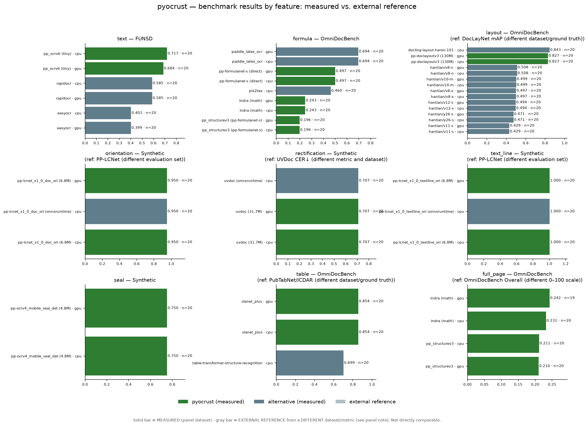
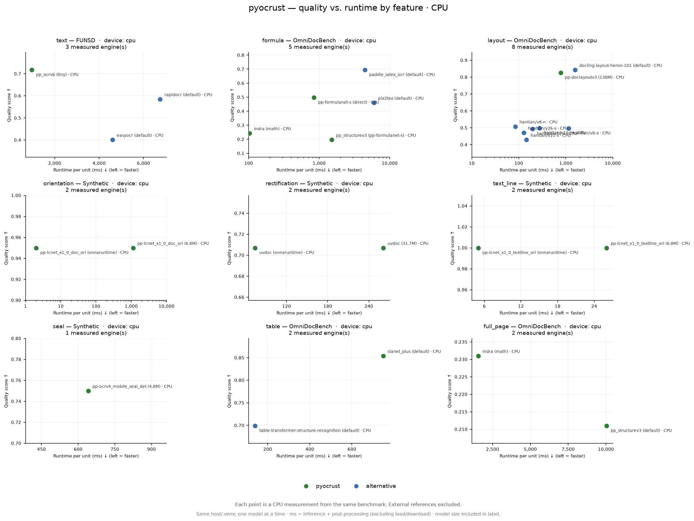

# pyocrust

[](https://pypi.org/project/pyocrust/)
[](https://github.com/vquilon/pyocrust/actions/workflows/ci-cd.yml)
[](https://github.com/vquilon/pyocrust/actions/workflows/ci-cd-test.yml)
[](https://github.com/vquilon/pyocrust/actions/workflows/ci-cd-gpu.yml)
[](https://github.com/vquilon/pyocrust/actions/workflows/ci-cd-gpu-test.yml)
[](LICENSE)

Wrapper nativo en **Rust** (PyO3 + Maturin) con tres familias de presets: OCR de texto
(`pp_ocrv6*`), estructura documental (`pp_structurev3`) e `indra`, sobre el crate
[`oar-ocr`](https://crates.io/crates/oar-ocr) `0.10.1`.

Este repositorio **es** el paquete Python: `rust-bindings/pyocrust/` es a la vez
la raíz del crate `pyocrust_core` y el directorio del paquete importable
`pyocrust/`.

## Instalación

`pyocrust` se publica como dos distribuciones construidas desde este mismo
código fuente, igual que `onnxruntime` y `onnxruntime-gpu`:

```bash
pip install pyocrust        # build CPU (portable, sin CUDA)
pip install pyocrust-gpu    # build CUDA (GPU NVIDIA)
```

> [!IMPORTANT]
> **Instala solo una de las dos.** `pyocrust` y `pyocrust-gpu` se importan como
> el mismo módulo (`import pyocrust`) y traen el **mismo** binario nativo
> (`pyocrust/_pyocrust_core`): instalar ambas sobrescribe la extensión de la otra.
> Son dos builds de una misma API, no dos paquetes que se combinen.

Las dos distribuciones exponen la misma API de Python —las mismas tres familias
de presets y once predictores de tarea—; solo cambia el binario nativo:

| Distribución | Feature compilada | Proveedores de ejecución de ONNX Runtime | Runtime adicional en destino | Plataformas |
| :--- | :--- | :--- | :--- | :--- |
| `pyocrust` | *(por defecto)* `simd` + `auto-download` | CPU | ninguno | Linux `x86_64`/`aarch64`, Windows `x86_64`, macOS `aarch64` |
| `pyocrust-gpu` | `cuda` | CPU + CUDA | driver NVIDIA + CUDA/cuDNN | Linux `x86_64`/`aarch64`, Windows `x86_64` (**sin macOS**) |

`pyocrust-gpu` es la misma API compilada con la feature `cuda`. No está
verificado aquí si el proveedor de ejecución CUDA de ONNX Runtime queda
realmente activo en el wheel empaquetado (ver `benchmarks/GPU.md`, tarjeta
`t_8a0f369f`): el wheel puede no incluirlo, y en ese caso la ejecución cae a
CPU. Cuando está activo necesita el driver de NVIDIA más el runtime CUDA/cuDNN
en el destino. La ejecución en GPU **no está validada** todavía en este
proyecto (ver `IMPLEMENTATION_AUDIT.md`); las distribuciones CPU siguen siendo
el camino verificado.

> [!WARNING]
> Solo se publican wheels para **Linux `x86_64`/`aarch64` (glibc), Windows
> `x86_64` y macOS `aarch64` (Apple Silicon)**. **Windows `i686` (32 bits) y
> macOS `x86_64` (Intel) no están soportados**, y tampoco se publica un sdist
> (código fuente): en esas plataformas `pip install pyocrust` falla con
> *No matching distribution found*, y compilar desde el código no lo arregla:
> `oar-ocr` se compila con su feature por defecto `download-binaries` y el
> catálogo de binarios de ONNX Runtime de `ort-sys` no publica esas dos
> arquitecturas.

## Uso rápido

```python
from pyocrust import VeloceOCR

# OCR de texto
engine = VeloceOCR("pp_ocrv6")
result = engine.recognize("documento.png")
print(result.text)

# Estructura documental (markdown)
engine = VeloceOCR("pp_structurev3")
result = engine.recognize("documento.png")
print(result.markdown)

# Tarea individual
from pyocrust import TaskPredictor
predictor = TaskPredictor("formula_recognition")
print(predictor.predict("formula.png")["formula"])
```

## Estado

Instantánea histórica de las fases 0-5 del `PLANNING.md`: `cargo check` compila,
`import pyocrust` funciona y la suite de integración pasa (31 pasados, 2 `skip`,
1 `xfail`). **Sin embargo, el sign-off final `S1` es `RECHAZADO`** con 7
condiciones abiertas, dos de ellas bloqueantes; ver `DESIGN.md` §9 y
`PLANNING.md` §7.

`S2.2` (Indra) tiene aceptación arquitectónica **parcial**: smoke CPU con dos
regiones, dos elementos y Markdown; una prueba Python y una Rust de giro inverso
pasadas, según la evidencia comunicada. GPU, calidad matemática y suite global
siguen pendientes. La descarga Rust HF falla por TLS; el diagnóstico con `urllib`
no valida `ensure_models`. Ver `DESIGN.md` §3.1.1 y `PLANNING.md`.

`S2.5/S2.6`: exposición Python documentada **11/11 predictores + 3/3 familias
de pipelines**, no once inferencias verificadas. El cierre focal offline registra
**14 pass, 4 skip, 0 fallos**: Tiny reconoce texto e Indra conserva matemática
inline en Markdown. Quedan cuatro tareas layout/tablas sin inferencia por caché
faltante, PP-StructureV3 sin caché completa, descarga fría/redescarga y GPU sin
validar. Evidencia, skips y alcance en `PLANNING.md`, actualización S2.5/S2.6;
no sustituye el histórico ni constituye sign-off global.

## Presets y salida

| Preset | Salida |
| :--- | :--- |
| `pp_ocrv6` / `pp_ocrv6_tiny`, `pp_ocrv6_small`, `pp_ocrv6_medium` | `OcrResult` |
| `pp_structurev3` | `StructureResult` |
| `indra` | `StructureResult` (Markdown, regiones y bloques) |

`VeloceOCR('indra')` usa el mismo `ensure_models`, con `.math(true)` y nueve
artefactos requeridos en `<models_dir>/indra/`. `models_status()['indra']` es el
catálogo completo (`required=false`); `models_status()['presets']['indra']`
enumera los nueve requisitos efectivos (`required=true`).
En Indra, la confianza de bloque `0.0` indica score no disponible; `formulas=[]`
no implica ausencia matemática: el LaTeX inline se conserva en Markdown/regiones.

## Tareas individuales (`TaskPredictor`)

Once tareas disponibles; nombres, esquemas y opciones en `DESIGN.md` §3.1.2.
Ejemplo con un modelo local explícito (sin descarga implícita):

```python
from pyocrust import TaskPredictor

predictor = TaskPredictor("text_detection", models="/ruta/pp-ocrv6_tiny_det.onnx")
print(predictor.predict("document.png")["detections"])
results = predictor.predict_batch(["document.png", "otra.png"])
```

`predict` acepta ruta, `PathLike` o bytes; batch conserva orden. `models=None`
gestiona artefactos registrados y puede descargar; rutas explícitas deben existir.
Exposición no certifica inferencia de las once tareas, calidad ni GPU.

### Ejemplos por familia

**Detección** (`text_detection`, `seal_text_detection`):

```python
from pyocrust import TaskPredictor

predictor = TaskPredictor("text_detection", models="/ruta/pp-ocrv6_tiny_det.onnx")
print(predictor.predict("document.png")["detections"])
# [{"bbox": [[x1,y1],[x2,y1],[x2,y2],[x1,y2]], "score": 0.95}, ...]
```

**Fórmula** (`formula_recognition`):

```python
predictor = TaskPredictor("formula_recognition")
print(predictor.predict("formula.png")["formula"])
# "E = mc^2"
```

**Orientación** (`document_orientation`, `text_line_orientation`):

```python
predictor = TaskPredictor("document_orientation")
print(predictor.predict("page.png")["orientations"])
# [{"class_id": 0, "label": "0°", "score": 0.98}, ...]
```

## Cobertura de la API

Once predictores individuales más tres familias de pipelines:

| Tipo | Identificador | Símbolo público | Estado |
| :--- | :--- | :--- | :--- |
| Predictor | `text_detection` | `TaskPredictor("text_detection")` | Expuesto |
| Predictor | `text_recognition` | `TaskPredictor("text_recognition")` | Expuesto |
| Predictor | `layout_detection` | `TaskPredictor("layout_detection")` | Expuesto |
| Predictor | `table_classification` | `TaskPredictor("table_classification")` | Expuesto |
| Predictor | `table_structure_recognition` | `TaskPredictor("table_structure_recognition")` | Expuesto |
| Predictor | `table_cell_detection` | `TaskPredictor("table_cell_detection")` | Expuesto |
| Predictor | `document_orientation` | `TaskPredictor("document_orientation")` | Expuesto |
| Predictor | `document_rectification` | `TaskPredictor("document_rectification")` | Expuesto |
| Predictor | `text_line_orientation` | `TaskPredictor("text_line_orientation")` | Expuesto |
| Predictor | `seal_text_detection` | `TaskPredictor("seal_text_detection")` | Expuesto |
| Predictor | `formula_recognition` | `TaskPredictor("formula_recognition")` | Expuesto |
| Pipeline | `pp_ocrv6` | `VeloceOCR("pp_ocrv6")` | Expuesto |
| Pipeline | `pp_structurev3` | `VeloceOCR("pp_structurev3")` | Expuesto |
| Pipeline | `indra` | `VeloceOCR("indra")` | Expuesto |

La exposición por constructor/introspección no equivale a inferencia verificada de
las 14 entradas. Detalles y límites en `PLANNING.md`, actualización `S2.5/S2.6`.

## Modelos

### Dónde se guardan

`pyocrust` resuelve el directorio de modelos en este orden de prioridad:

1. Parámetro `custom_path` en `VeloceOCR(preset, custom_path=...)`.
2. Variable de entorno `OAR_HOME`.
3. Variable de entorno `OCR_MODELS_CACHE_DIR`.
4. `~/.oar` (ruta por defecto de `oar-ocr`).

`pyocrust.models_status()` devuelve el directorio resuelto en `models_dir`. En
este host, el valor real es `C:\Users\vquilon\.oar`.

### Cómo se descargan solos

Dos orígenes, según el preset o la tarea:

* **ModelScope** (`greatv/oar-ocr`): provee los artefactos de los 11 predictores
  individuales y de los presets `pp_ocrv6*` / `pp_structurev3`. Lo gestiona el
  `auto-download` integrado en `oar-ocr` o el preflight nativo de `pyocrust`
  (`src/storage/models.rs:224-242`).
* **HuggingFace** (`datalab-to/indra-ocr`, revisión `bd02167f...`): provee los
  nueve artefactos de `indra`. La descarga la ejecuta el preflight nativo cuando
  `ensure_models` detecta faltantes.

El preflight (`VeloceOCR::new` / `TaskPredictor::new`) comprueba tamaño y,
para Indra, hash SHA-256 antes de cargar. Si todo está en disco, no toca la red.

### Cuánto ocupan

Los tamaños son los del registro y del disco local; no son memoria de ejecución.

| Preset / tarea | Artefactos | Tamaño aproximado |
| :--- | :--- | :--- |
| `pp_ocrv6` (Tiny) | 3 | ~6,3 MB |
| `pp_structurev3` | 11 | ~936 MB |
| `indra` (requeridos) | 9 | ~27 MB |

Los diccionarios de texto y tabla, el tokenizer de fórmulas y los JSON de
metadatos son compañeros del modelo, no modelos separados.

### Forzar offline

```bash
PYOCRUST_OFFLINE=1 python -c "from pyocrust import VeloceOCR; VeloceOCR('pp_ocrv6')"
```

Con `PYOCRUST_OFFLINE=1` y artefactos ausentes, el constructor falla con
`PyOcrRuntimeError` y el comando exacto para descargar. Unset, `0`, `false` o
`no` (case-insensitive) desactiva el modo offline.

### Prefetchear

La forma honesta es construir el predictor/preset con `models=None` después de
haberlo creado, o llamar a `models_status()` para inspeccionar el estado en
disco sin descargar:

```python
from pyocrust import models_status, VeloceOCR

print(models_status()["models_dir"])
# Si faltan artefactos, la construcción implícita los descarga:
engine = VeloceOCR("pp_ocrv6")
```

No hay una API pública de "prefetch only": la descarga se produce como efecto
secundario del preflight conectado (`S2.0` cierra `S1.4`).

## Modelos y resolvedor

### Resolver de pipeline

`resolve_pipeline` elige un preset/tarea sin cargar modelos ni descargar.
Tres casos típicos:

```python
# 1) OCR rápido en CPU
from pyocrust import TaskSpec, resolve_pipeline

choice = resolve_pipeline(TaskSpec(ocr_only=True, quality="speed"))
print(choice.id)       # pp_ocrv6_tiny
print(choice.preset)   # pp_ocrv6
print(choice.size)     # tiny
```

```python
# 2) Documento escaneado con fórmulas
from pyocrust import TaskSpec, resolve_pipeline

choice = resolve_pipeline(
    TaskSpec(document_kind="scanned", formulas="with_text", output_format="markdown")
)
print(choice.id)                # pp_structurev3
print(choice.tasks)             # ('document_orientation', 'document_rectification')
```

```python
# 3) Precisión en GPU
from pyocrust import TaskSpec, HardwareProfile, GpuInfo, resolve_pipeline

hardware = HardwareProfile(
    cpu_count=20,
    ram_bytes=64 * 1024**3,
    gpu=GpuInfo(name="RTX PRO 4000 Blackwell", vram_bytes=16 * 1024**3),
)
choice = resolve_pipeline(
    TaskSpec(ocr_only=True, quality="accuracy"), hardware=hardware
)
print(choice.id)        # pp_ocrv6_medium
print(choice.tasks)     # ('indra',) — alternativa recomendada, no ejecución automática
```

`PipelineChoice` expone `preset`, `size`, `tasks`, `models_dir` y `offline`;
la propiedad `id` se pasa directamente a `VeloceOCR(preset=choice.id)`.
Las tareas recomendadas no se ejecutan automáticamente.

### Huella de pipelines

`pipeline_profiles()` devuelve la huella exacta de cada preset y tarea
registrada. `disk_bytes` suma los tamaños del registro upstream; `ram_bytes`
es siempre `None` (no se mide en runtime). Indra conserva `None` porque
alguno de sus artefactos no está en `oar-ocr`.

| ID | Familia | disk_bytes | ram_bytes |
| :--- | :--- | :--- | :--- |
| `pp_ocrv6_tiny` | `pp_ocrv6` | 6 270 385 | — |
| `pp_ocrv6_small` | `pp_ocrv6` | 31 114 837 | — |
| `pp_ocrv6_medium` | `pp_ocrv6` | 138 662 763 | — |
| `pp_structurev3` | `pp_structurev3` | 881 880 022 | — |
| `indra` | `indra` | — | — |
| `text_detection` | `task` | 1 780 590 | — |
| `text_recognition` | `task` | 4 489 795 | — |
| `layout_detection` | `task` | 129 955 811 | — |
| `document_orientation` | `task` | 6 787 248 | — |
| `document_rectification` | `task` | 31 684 150 | — |
| `text_line_orientation` | `task` | 6 776 997 | — |
| `seal_text_detection` | `task` | 4 826 518 | — |
| `formula_recognition` | `task` | 234 018 918 | — |
| `table_classification` | `task` | 6 776 998 | — |
| `table_structure_recognition` | `task` | 367 743 951 | — |
| `table_cell_detection` | `task` | 129 331 821 | — |

### Variables de entorno

| Variable | Efecto |
| :--- | :--- |
| `OAR_HOME` | Directorio primario de modelos. Gana a `OCR_MODELS_CACHE_DIR` y a `~/.oar`. |
| `OCR_MODELS_CACHE_DIR` | Directorio compartido de modelos. Usado solo si `OAR_HOME` no está definida. |
| `PYOCRUST_OFFLINE` | Si es `1`, `true` o `yes` (case-insensitive), bloquea descargas. El resolvedor lo lee para reflejar el modo en `PipelineChoice.offline`. |
| `CUDA_LAUNCH_BLOCKING` | Depuración de CUDA. La propaga `oar-ocr` / ONNX Runtime. |
| `RUST_LOG` | Logging del crate Rust (`oar-ocr`, `reqwest`). |
| `OAR_VL_DTYPE` | Documentada en `oar-ocr` para VLM. **Sin efecto en v1** (feature `vl` reservada para v2, ADR-001). |
| `OAR_VL_ATTN_FULL_SEQ_THRESHOLD` | Ídem. **Sin efecto en v1**. |
| `OAR_VL_DISABLE_*` | Familia de flags de VLM. **Sin efecto en v1**. |

## Catálogo y recomendación (`S3`, aprobación acotada)

`model_catalog()` describe modelos/diccionarios/tokenizers; `pipeline_profiles()`
expone presets y tareas del registro real. Parámetros y RAM desconocidos son
`None`; los tamaños son de archivo, no memoria de ejecución. Indra conserva
`size_bytes=None`/`disk_bytes=None` en estas consultas. Contrato completo:
`DESIGN.md` §3.1.3; evidencia comunicada: `PLANNING.md`, actualización S3.

### Solo recomendar (sin modelos, descargas ni preflight)

```python
from pyocrust import TaskSpec, detect_hardware, resolve_pipeline, pipeline_profiles

hardware = detect_hardware()  # inventario físico; no prueba CUDA en el wheel
choice = resolve_pipeline(
    TaskSpec(document_kind="scanned", tables=True, output_format="markdown"),
    hardware=hardware,
)
print(choice.id, choice.tasks, choice.models_dir, choice.offline)
print(pipeline_profiles()[choice.id])
```

Un `HardwareProfile` explícito evita la detección. Resolver puede normalizar y
reexportar `OAR_HOME` relativa mediante la resolución nativa (§7.1), pero no
carga modelos. Las tareas recomendadas no se ejecutan; Indra puede aparecer como
alternativa heurística, sin garantía de disponibilidad ni GPU. `output_format`
orienta la selección, no convierte resultados.

### Ejecutar después, explícitamente (puede cargar/descargar modelos)

```python
from pyocrust import VeloceOCR

# Ejemplo independiente: requiere artefactos; offline con faltantes da error.
engine = VeloceOCR("pp_structurev3")
result = engine.recognize("document.png")
print(result.to_markdown())
```

No ejecuta automáticamente orientación/rectificación ni alternativas del resolver.
GPU, calidad y disponibilidad local no están certificadas por la aprobación S3.

## Estructura

```text
pyocrust/
├── Cargo.toml          # Crate pyocrust_core (cdylib, edition 2024)
├── pyproject.toml      # Backend Maturin, module-name = "pyocrust._pyocrust_core"
├── src/
│   ├── lib.rs          # #[pymodule] #[pyo3(name = "_pyocrust_core")]
│   ├── core/
│   │   ├── error.rs    # PyOcrError, PyOcrValueError, PyOcrRuntimeError
│   │   ├── image_processor.rs  # TileStrategy, pre/post-procesado
│   │   └── types.rs    # OcrResult, StructureResult, RecognitionResult
│   ├── engines/
│   │   ├── oar_text.rs       # motor pp_ocrv6 (tinta)
│   │   ├── oar_structure.rs  # motor pp_structurev3 (tabla/Layout)
│   │   └── oar_indra.rs      # motor indra (markdown + bloques)
│   ├── storage/
│   │   ├── registry.rs       # 11 artefactos ModelScope + 9 indra (HF)
│   │   ├── models.rs         # ensure_models / preflight / paralelismo 4 hilos
│   │   ├── download.rs       # descargas paralelas con sidecar SHA-256
│   │   ├── catalog.rs        # model_catalog / pipeline_profiles
│   │   └── config.rs         # OAR_HOME / OCR_MODELS_CACHE_DIR
│   └── tasks/
│       └── mod.rs            # TaskPredictor: 11 tareas + predict_batch
├── pyocrust/           # Paquete Python importable
│   ├── __init__.py     # Fachada pública
│   ├── __init__.pyi    # Stubs de tipos
│   ├── hardware.py     # detect_hardware, HardwareProfile
│   ├── resolver.py     # resolve_pipeline, TaskSpec
│   └── py.typed        # Marcador PEP 561
└── tests/              # Tarjeta V1
```

## Requisitos

- Rust toolchain con `rustc`/`cargo` **1.95** o superior (MSRV de `oar-ocr`).
- Python **3.10** o superior (el crate usa `abi3-py310`).
- **El banco de benchmarks exige Python 3.12**, y eso es lo que hay en el
  `.venv/Scripts/python.exe` del repo: `paddlepaddle-gpu` y las wheels CUDA de
  `torch`/`torchvision` no publican builds para Windows en 3.13/3.14 (en 3.14
  `pip install torch` resuelve en silencio a la wheel de CPU, así que el eje GPU de
  la comparativa no se puede medir). El crate de Rust sigue cubriendo 3.10+ vía
  `abi3-py310`: es una restricción del banco de medida, no del paquete.
- El set de dependencias del banco **fija `protobuf==3.20.3`**: `paddlepaddle-gpu`
  2.6.2 pide `protobuf<=3.20.2` en Windows mientras que `onnxruntime-gpu` pide
  `>=4.25`. Con 3.20.3 funcionan los dos (verificado con una sesión CUDA real de
  ORT); si `paddlex` lo sube, `import paddle` muere con un `TypeError: Descriptors
  cannot be created directly`.
- Enlazador de C: en Windows, MSVC Build Tools (`cl.exe` en el `PATH`).

## Desarrollo

```bash
python -m venv .venv
source .venv/Scripts/activate   # Windows Git-Bash

pip install maturin
maturin develop                 # compila y deja importable pyocrust en el venv

python -c "import pyocrust; print(pyocrust.__version__)"
```

`maturin develop` usa el perfil `release` por defecto. El perfil declara
`panic = "unwind"` (ADR-004): un pánico de Rust se traduce a excepción de Python
en lugar de abortar el intérprete.

### Comprobaciones rápidas

```bash
cargo check        # sin enlazar; valida el crate y sus dependencias
cargo test         # tests unitarios de Rust (tarjeta I2)
python -m pytest tests/ -q   # tests de integración (tarjeta V1)
```

## Features

| Feature | Efecto |
| :--- | :--- |
| *(por defecto)* | CPU. `download-binaries` + `simd` de `oar-ocr`; liga el ONNX Runtime que trae el crate. |
| `cuda` | Proveedor CUDA de ONNX Runtime (NVIDIA). |
| `directml` | Proveedor DirectML de ONNX Runtime (Windows). |

```bash
maturin develop --features cuda        # build con aceleración GPU
```

La descarga de modelos desde ModelScope (`auto-download`) viene activada por
defecto en `oar-ocr` (ADR-010); el segundo camino de descarga, el descargador
propio desde Hugging Face, se implementa en `src/storage/download.rs` (tarjeta `I3`).
La feature `vl` (Candle / `oar-ocr-vl`) está reservada para v2 (ADR-001) y no
se declara todavía: no hay nada que compilar detrás de ella.

Los modelos se resuelven en este orden de prioridad (ver `DESIGN.md` §3.2):
parámetro `custom_path` → `OAR_HOME` / `OCR_MODELS_CACHE_DIR` → `~/.oar`.

## Licencias de los pesos

La licencia del código (`Apache-2.0`) no cubre los pesos: cada artefacto trae la
suya. El catálogo la expone por artefacto (`license`, `license_commercial_use`,
`license_acknowledge`, `license_restricted`, `license_notes`, `license_url`) y
`VeloceOCR`/`TaskPredictor` la aplican en el constructor, **antes** de descargar
o leer del disco:

```python
from pyocrust import VeloceOCR, model_catalog

model_catalog()["det.onnx"]["license"]               # 'OpenRAIL-M-Mod' (Indra)
model_catalog()["det.onnx"]["license_acknowledge"]   # True (§7)

VeloceOCR("pp_ocrv6")                                # Apache-2.0: permitido
VeloceOCR("indra")                                   # PyOcrValueError: no libre para comercial
VeloceOCR("indra", license_commercial_use=False)     # PyOcrValueError: §7 exige atribución
VeloceOCR("indra", license_commercial_use=False,
           license_acknowledge=True)                 # permitido (no comercial + atribución)
```

Los flags son **declaraciones del usuario** (intención comercial y aceptación de
atribución), no lo que el modelo permite. Lo no reconocido se trata como
restringido por defecto. Ver `DESIGN.md` ADR-017.

## Benchmarking

Fuera de `src/`, `benchmarks/` está organizado **por feature/componente** (como los
componentes de `oar-ocr`): cada capacidad tiene su banco, su métrica y alternativas
reales en Python. Mide **las 9 features**; cada número es `medido` (ejecutado
aquí) o `referencia` (citado de un paper con URL) — nunca mezclados sin etiquetar.





| Feature | Métrica titular ↑ | pyocrust (medido) | Mejor alternativa medida | Estado |
| :--- | :--- | ---: | :--- | :--- |
| `text` | F1 palabra | 0.717 | rapidocr 0.585 | medido |
| `formula` | Similitud LaTeX | 0.497 | paddle_latex_ocr 0.694 | medido |
| `layout` | mAP@IoU 0.5 | 0.827 | docling_heron_101 0.843 | medido |
| `orientation` | accuracy | 0.950 | lcnet_doc_ori 0.950 | medido |
| `rectification` | SSIM | 0.707 | uvdoc 0.707 | medido |
| `text_line` | accuracy | 1.000 | lcnet_textline_ori 1.000 | medido |
| `seal` | recall@IoU 0.5 | 0.750 | — | medido |
| `table` | TEDS estrut. | 0.854 | tatr 0.699 | medido |
| `full_page` | Markdown F1 | 0.231 | — | medido |

Los 9 bancos se ejecutaron con `--limit 20` (`n=20`, CPU, `warmup=1`, `repeats=1`, pyocrust
0.1.0). Se muestra el mejor motor de `pyocrust` por feature y, donde otra alternativa
**medida** gana (`formula`, `layout`), la tabla lo dice. Tablas por motor, provenance
completa (comando, dataset, `n`, runtime) y referencias externas con URL en
[`benchmarks/README.md`](benchmarks/README.md) y
[`benchmarks/reports/SUMMARY.md`](benchmarks/reports/SUMMARY.md).

**Cómo se mide la campaña.**

- **`n` uniforme** — todos los bancos usan el mismo `--limit`. `SUMMARY.md` y
  `SCOREBOARD.md` salen de un único colector de CSV
  (`benchmarks/features/summary.py::collect_rows`), así que no pueden divergir; los
  `REPORT.md` por feature los genera `report.py` (desde los CSV de cada run) y
  `QUALITY_VS_TIME.md` deriva de esos `REPORT.md`. `SCOREBOARD.md` declara `n` por fila:
  unas pocas alternativas de control de `formula` solo tienen run `n=5` y se muestran
  como tales, nunca fusionadas con las de `n=20`.
- **CPU vs GPU reales** — cada adaptador registra `provider_effective` (el EP que de
  verdad ejecutó). `--device gpu` sobre un motor sin acelerador queda `skipped` con
  motivo; un *fallback* a CPU nunca se reporta como GPU
  (ver `benchmarks/reports/CPU_VS_GPU.md`).
- **Licencia por motor** — la columna `license` es **informativa** (señala pesos no
  permisivos, p. ej. AGPL-3.0 en las referencias YOLOv10); la puerta vinculante es el
  catálogo + los flags de política (ADR-017), no esta columna.
- **Solo DocLayNet en `layout`** — solo son comparables los fine-tunes de DocLayNet: las
  filas YOLOv10 de referencia llevan mAP de DocLayNet y los YOLO medidos exponen las
  **11 clases de DocLayNet**, nunca las 80 de COCO.

```bash
# un banco por feature (ejemplo: detección + reconocimiento de texto)
./.venv/Scripts/python.exe benchmarks/features/text/bank.py --limit 20
# regenerar reportes por feature + los resúmenes globales
./.venv/Scripts/python.exe benchmarks/features/report.py --all
./.venv/Scripts/python.exe benchmarks/features/summary.py
```

Los motores no instalados quedan `skipped`, nunca como ejecutados; las métricas sin
ground truth son `N/A`, nunca `0`. `seal` no tiene set anotado a mano en caché: se mide
contra un set **sintético** determinista (`synthetic_seal`), declarado como tal.

## Publicación a PyPI (CI/CD)

La publicación la realizan dos workflows de GitHub Actions con `maturin` y
*trusted publishing* (OIDC: no hay token de PyPI guardado en secretos):

| Workflow | Destino | Disparador |
| :--- | :--- | :--- |
| `.github/workflows/ci-cd.yml` | PyPI | `workflow_dispatch` (manual) |
| `.github/workflows/ci-cd-test.yml` | TestPyPI | `release: published` + `workflow_dispatch` |
| `.github/workflows/ci-cd-gpu.yml` | PyPI (`pyocrust-gpu`) | `workflow_dispatch` (manual) |
| `.github/workflows/ci-cd-gpu-test.yml` | TestPyPI (`pyocrust-gpu`) | `release: published` + `workflow_dispatch` |

Los dos workflows `*-gpu` compilan el **mismo código** con `--features cuda`
y parchean el nombre del proyecto en `pyproject.toml` a `pyocrust-gpu` antes
de publicar. Usan su propio trusted publisher y sus propios entornos
(`pypi-gpu`, `testpypi-gpu`), y su matriz es solo CUDA: Linux
`x86_64`/`aarch64` y Windows `x86_64`, **macOS excluido** (no hay CUDA en
hardware Apple).

Ambos compilan la matriz de plataformas, validan cada wheel (integridad ZIP y
EOCD, sin datos sobrantes) y publican. Como `pyo3` se compila con `abi3-py310`,
un único wheel por plataforma cubre CPython 3.10-3.14: no se repite el build una
vez por versión de Python.

Plataformas: `x86_64`/`aarch64` Linux, `x86_64` Windows y `aarch64` macOS
(Apple Silicon). Se omiten `i686-pc-windows-msvc` (Windows x86) y
`x86_64-apple-darwin` (macOS Intel) porque `oar-ocr` se compila con su feature
por defecto `download-binaries` y el catálogo de binarios de ONNX Runtime de
`ort-sys` no publica esas dos arquitecturas: esos jobs fallarían al compilar.

### Requisitos previos (una sola vez)

1. Crear el proyecto en [TestPyPI](https://test.pypi.org/) y en
   [PyPI](https://pypi.org/).
2. En el repositorio de GitHub, crear los entornos (`Settings > Environments`)
   `testpypi` y `pypi`.
3. Configurar *trusted publishing* en cada proyecto apuntando al repositorio y al
   workflow correspondiente (`ci-cd.yml` para PyPI, `ci-cd-test.yml` para
   TestPyPI), sin secreto compartido.
4. Repetir 1-3 para las distribuciones GPU: crear el proyecto `pyocrust-gpu` en
   TestPyPI y PyPI, los entornos `testpypi-gpu` y `pypi-gpu`, y los trusted
   publishers de `ci-cd-gpu-test.yml` (TestPyPI) y `ci-cd-gpu.yml` (PyPI).

### Publicar

```text
TestPyPI:  Actions > "Publish pyocrust to TestPyPI" > Run workflow
           (o publicar un release, que lo dispara automáticamente)
PyPI:      Actions > "Publish pyocrust to PyPI" > Run workflow
TestPyPI GPU:  Actions > "Publish pyocrust-gpu to TestPyPI" > Run workflow
PyPI GPU:      Actions > "Publish pyocrust-gpu to PyPI" > Run workflow
```

### Comprobar el wheel antes de subir

```bash
./.venv/Scripts/python.exe -m maturin build --release --out dist
# Build GPU (CUDA):
./.venv/Scripts/python.exe -m maturin build --release --features cuda --out dist
pip install dist/pyocrust-0.1.0-cp310-abi3-*.whl
python -c "import pyocrust; print(pyocrust.__version__)"
```

El wheel queda en `dist/` (ignorado por git); en CI lo genera
`PyO3/maturin-action`.

## Licencia

Apache-2.0, idéntica a la de `oar-ocr`. Ver `LICENSE`.
