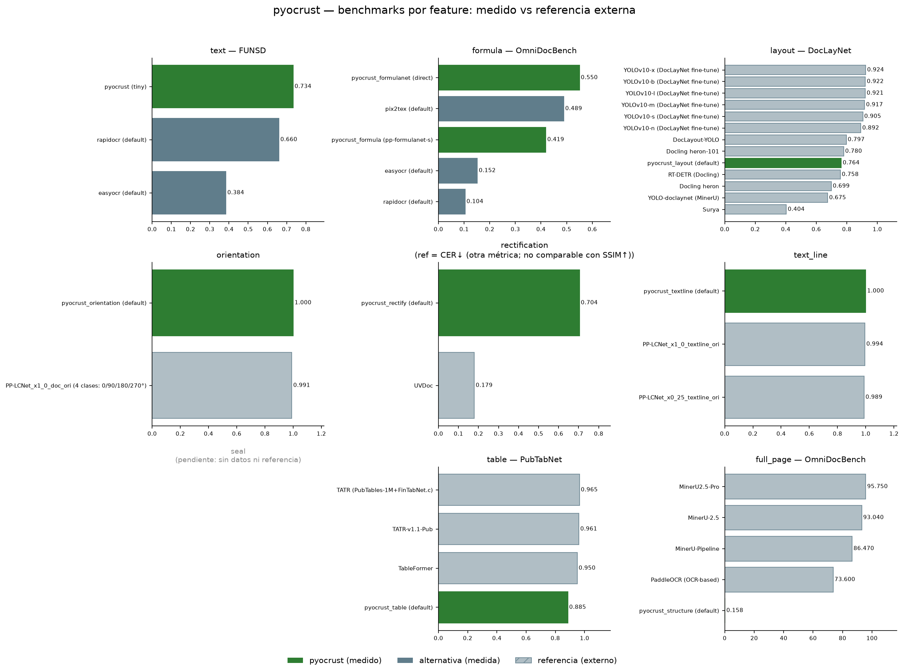

# pyocrust

[](https://pypi.org/project/pyocrust/)
[](https://github.com/vquilon/pyocrust/actions/workflows/ci-cd.yml)
[](https://github.com/vquilon/pyocrust/actions/workflows/ci-cd-test.yml)
[](https://github.com/vquilon/pyocrust/actions/workflows/ci-cd-gpu.yml)
[](https://github.com/vquilon/pyocrust/actions/workflows/ci-cd-gpu-test.yml)
[](LICENSE)

Native **Rust** wrapper (PyO3 + Maturin) with three preset families: text OCR
(`pp_ocrv6*`), document structure (`pp_structurev3`) and `indra`, built on the crate
[`oar-ocr`](https://crates.io/crates/oar-ocr) `0.10.1`.

This repository **is** the Python package: `rust-bindings/pyocrust/` is both
the `pyocrust_core` crate root and the importable package directory
`pyocrust/`.

## Installation

`pyocrust` ships as two distributions built from this same source tree, the same
way `onnxruntime` and `onnxruntime-gpu` do:

```bash
pip install pyocrust        # CPU build (portable, no CUDA)
pip install pyocrust-gpu    # CUDA build (NVIDIA GPUs)
```

> [!IMPORTANT]
> **Install only one of the two.** `pyocrust` and `pyocrust-gpu` import as the
> same module (`import pyocrust`) and ship the **same** native binary
> (`pyocrust/_pyocrust_core`); installing both overwrites the other's extension.
> They are two builds of one API, not two packages you combine.

Both distributions expose the identical Python API — the same three preset
families and eleven task predictors; only the native binary changes:

| Distribution | Compiled feature | ONNX Runtime execution providers | Extra runtime at the destination | Platforms |
| :--- | :--- | :--- | :--- | :--- |
| `pyocrust` | *(default)* `simd` + `auto-download` | CPU | none | Linux `x86_64`/`aarch64`, Windows `x86_64`, macOS `aarch64` |
| `pyocrust-gpu` | `cuda` | CPU + CUDA | NVIDIA driver + CUDA/cuDNN | Linux `x86_64`/`aarch64`, Windows `x86_64` (**no macOS**) |

`pyocrust-gpu` is the same API compiled with the `cuda` feature. Whether the
CUDA execution provider of ONNX Runtime ends up actually active in the packaged
wheel is **not verified** here (see `benchmarks/GPU.md`, task `t_8a0f369f`): the
wheel may not ship it, in which case execution falls back to CPU. When active it
needs the NVIDIA driver plus the CUDA/cuDNN runtime at the destination. GPU
execution is **not validated** in this project yet (see
`IMPLEMENTATION_AUDIT.md`); the CPU distributions remain the verified path.

> [!WARNING]
> Wheels are published only for **Linux `x86_64`/`aarch64` (glibc), Windows
> `x86_64` and macOS `aarch64` (Apple Silicon)**. **Windows `i686` (32-bit) and
> macOS `x86_64` (Intel) are not supported**, and no source distribution is
> published either: on those platforms `pip install pyocrust` fails with *No
> matching distribution found*, and compiling from source does not help —
> `oar-ocr` builds with its default `download-binaries` feature and the ONNX
> Runtime binary catalog published by `ort-sys` ships no binaries for them.

## Quick start

```python
from pyocrust import VeloceOCR

# Text OCR
engine = VeloceOCR("pp_ocrv6")
result = engine.recognize("document.png")
print(result.text)

# Document structure (markdown)
engine = VeloceOCR("pp_structurev3")
result = engine.recognize("document.png")
print(result.markdown)

# Individual task
from pyocrust import TaskPredictor
predictor = TaskPredictor("formula_recognition")
print(predictor.predict("formula.png")["formula"])
```

## Status

Historical snapshot of phases 0-5 from `PLANNING.md`: `cargo check` compiles,
`import pyocrust` works and the integration suite passes (31 passed, 2 `skip`,
1 `xfail`). However, the final `S1` sign-off is **REJECTED** with 7
open conditions, two of them blocking; see `DESIGN.md` §9 and
`PLANNING.md` §7.

`S2.2` (Indra) has **partial** architectural acceptance: CPU smoke test with two
regions, two elements and Markdown; one Python and one Rust reverse-rotation
test passed, per the reported evidence. GPU, mathematical quality and the full
suite are still pending. The Rust HF download fails due to TLS; the `urllib`
diagnostic does not validate `ensure_models`. See `DESIGN.md` §3.1.1 and `PLANNING.md`.

`S2.5/S2.6`: Python exposure documents **11/11 predictors + 3/3 pipeline
families**, not all eleven inferences verified. The offline focal closure records
**14 pass, 4 skip, 0 failures**: Tiny recognizes text and Indra preserves inline math
in Markdown. Four layout/table tasks remain without inference due to missing cache,
PP-StructureV3 without full cache, cold download/redownload and GPU still
unvalidated. Evidence, skips and scope in `PLANNING.md`, S2.5/S2.6 update;
does not replace the history nor constitutes global sign-off.

## Presets and output

| Preset | Output |
| :--- | :--- |
| `pp_ocrv6` / `pp_ocrv6_tiny`, `pp_ocrv6_small`, `pp_ocrv6_medium` | `OcrResult` |
| `pp_structurev3` | `StructureResult` |
| `indra` | `StructureResult` (Markdown, regions and blocks) |

`VeloceOCR('indra')` uses the same `ensure_models`, with `.math(true)` and nine
required artifacts in `<models_dir>/indra/`. `models_status()['indra']` is the
full catalog (`required=false`); `models_status()['presets']['indra']`
lists the nine effective requirements (`required=true`).
In Indra, block confidence `0.0` means score not available; `formulas=[]`
does not imply absence of math: inline LaTeX is preserved in Markdown/regions.

## Individual tasks (`TaskPredictor`)

Eleven tasks available; names, schemas and options in `DESIGN.md` §3.1.2.
Example with an explicit local model (no implicit download):

```python
from pyocrust import TaskPredictor

predictor = TaskPredictor("text_detection", models="/path/to/pp-ocrv6_tiny_det.onnx")
print(predictor.predict("document.png")["detections"])
results = predictor.predict_batch(["document.png", "another.png"])
```

`predict` accepts path, `PathLike` or bytes; batch preserves order. `models=None`
manages registered artifacts and may download; explicit paths must exist.
Exposure does not certify inference of all eleven tasks, quality or GPU.

### Examples by family

**Detection** (`text_detection`, `seal_text_detection`):

```python
from pyocrust import TaskPredictor

predictor = TaskPredictor("text_detection", models="/path/to/pp-ocrv6_tiny_det.onnx")
print(predictor.predict("document.png")["detections"])
# [{"bbox": [[x1,y1],[x2,y1],[x2,y2],[x1,y2]], "score": 0.95}, ...]
```

**Formula** (`formula_recognition`):

```python
predictor = TaskPredictor("formula_recognition")
print(predictor.predict("formula.png")["formula"])
# "E = mc^2"
```

**Orientation** (`document_orientation`, `text_line_orientation`):

```python
predictor = TaskPredictor("document_orientation")
print(predictor.predict("page.png")["orientations"])
# [{"class_id": 0, "label": "0°", "score": 0.98}, ...]
```

## API coverage

Once individual predictors plus three pipeline families:

| Type | Identifier | Public symbol | Status |
| :--- | :--- | :--- | :--- |
| Predictor | `text_detection` | `TaskPredictor("text_detection")` | Exposed |
| Predictor | `text_recognition` | `TaskPredictor("text_recognition")` | Exposed |
| Predictor | `layout_detection` | `TaskPredictor("layout_detection")` | Exposed |
| Predictor | `table_classification` | `TaskPredictor("table_classification")` | Exposed |
| Predictor | `table_structure_recognition` | `TaskPredictor("table_structure_recognition")` | Exposed |
| Predictor | `table_cell_detection` | `TaskPredictor("table_cell_detection")` | Exposed |
| Predictor | `document_orientation` | `TaskPredictor("document_orientation")` | Exposed |
| Predictor | `document_rectification` | `TaskPredictor("document_rectification")` | Exposed |
| Predictor | `text_line_orientation` | `TaskPredictor("text_line_orientation")` | Exposed |
| Predictor | `seal_text_detection` | `TaskPredictor("seal_text_detection")` | Exposed |
| Predictor | `formula_recognition` | `TaskPredictor("formula_recognition")` | Exposed |
| Pipeline | `pp_ocrv6` | `VeloceOCR("pp_ocrv6")` | Exposed |
| Pipeline | `pp_structurev3` | `VeloceOCR("pp_structurev3")` | Exposed |
| Pipeline | `indra` | `VeloceOCR("indra")` | Exposed |

Exposure via constructor/introspection does not equate to verified inference of
all 14 entries. Details and limits in `PLANNING.md`, `S2.5/S2.6` update.

## Models

### Where they are stored

`pyocrust` resolves the models directory in this priority order:

1. `custom_path` parameter in `VeloceOCR(preset, custom_path=...)`.
2. `OAR_HOME` environment variable.
3. `OCR_MODELS_CACHE_DIR` environment variable.
4. `~/.oar` (default path of `oar-ocr`).

`pyocrust.models_status()` returns the resolved directory in `models_dir`. On
this host, the actual value is `C:\Users\vquilon\.oar`.

### How they self-download

Two origins, depending on the preset or task:

* **ModelScope** (`greatv/oar-ocr`): provides artifacts for the 11 individual predictors
  and the `pp_ocrv6*` / `pp_structurev3` presets. Managed by the
  `auto-download` integrated in `oar-ocr` or the native `pyocrust` preflight
  (`src/storage/models.rs:224-242`).
* **HuggingFace** (`datalab-to/indra-ocr`, revision `bd02167f...`): provides the
  nine `indra` artifacts. The download runs from the native preflight when
  `ensure_models` detects missing artifacts.

The preflight (`VeloceOCR::new` / `TaskPredictor::new`) checks size and,
for Indra, SHA-256 hash before loading. If everything is on disk, it does not touch the network.

### Size

Sizes are from the registry and local disk; they are not runtime memory.

| Preset / task | Artifacts | Approximate size |
| :--- | :--- | :--- |
| `pp_ocrv6` (Tiny) | 3 | ~6.3 MB |
| `pp_structurev3` | 11 | ~936 MB |
| `indra` (required) | 9 | ~27 MB |

Text and table dictionaries, the formulas tokenizer and metadata JSON files
are model companions, not separate models.

### Force offline

```bash
PYOCRUST_OFFLINE=1 python -c "from pyocrust import VeloceOCR; VeloceOCR('pp_ocrv6')"
```

With `PYOCRUST_OFFLINE=1` and missing artifacts, the constructor fails with
`PyOcrRuntimeError` and the exact download command. Unset, `0`, `false` or
`no` (case-insensitive) disables offline mode.

### Prefetch

The honest way is to build the predictor/preset with `models=None` after
creating it, or call `models_status()` to inspect the on-disk state without
downloading:

```python
from pyocrust import models_status, VeloceOCR

print(models_status()["models_dir"])
# If artifacts are missing, implicit construction downloads them:
engine = VeloceOCR("pp_ocrv6")
```

There is no public "prefetch only" API: download happens as a side effect of
the connected preflight (`S2.0` closes `S1.4`).

## Models and resolver

### Pipeline resolver

`resolve_pipeline` chooses a preset/task without loading models or downloading.
Three typical cases:

```python
# 1) Fast OCR on CPU
from pyocrust import TaskSpec, resolve_pipeline

choice = resolve_pipeline(TaskSpec(ocr_only=True, quality="speed"))
print(choice.id)       # pp_ocrv6_tiny
print(choice.preset)   # pp_ocrv6
print(choice.size)     # tiny
```

```python
# 2) Scanned document with formulas
from pyocrust import TaskSpec, resolve_pipeline

choice = resolve_pipeline(
    TaskSpec(document_kind="scanned", formulas="with_text", output_format="markdown")
)
print(choice.id)                # pp_structurev3
print(choice.tasks)             # ('document_orientation', 'document_rectification')
```

```python
# 3) GPU accuracy
from pyocrust import TaskSpec, HardwareProfile, GpuInfo, resolve_pipeline

hardware = HardwareProfile(
    cpu_count=20,
    ram_bytes=64 * 1024**3,
    gpu=GpuInfo(name="RTX PRO 4000 Blackwell", vram_bytes=16 * 1024**3),
)
choice = resolve_pipeline(
    TaskSpec(ocr_only=True, quality="accuracy"), hardware=hardware
)
print(choice.id)        # pp_ocrv6_medium
print(choice.tasks)     # ('indra',) — recommended alternative, not automatic execution
```

`PipelineChoice` exposes `preset`, `size`, `tasks`, `models_dir` and `offline`;
the `id` property is passed directly to `VeloceOCR(preset=choice.id)`.
Recommended tasks are not executed automatically.

### Pipeline footprint

`pipeline_profiles()` returns the exact footprint of each registered preset and task.
`disk_bytes` sums upstream registry sizes; `ram_bytes` is always `None` (not measured at runtime).
Indra keeps `None` because some of its artifacts are not in `oar-ocr`.

| ID | Family | disk_bytes | ram_bytes |
| :--- | :--- | ---: | --- |
| `pp_ocrv6_tiny` | `pp_ocrv6` | 6 270 385 | — |
| `pp_ocrv6_small` | `pp_ocrv6` | 31 114 837 | — |
| `pp_ocrv6_medium` | `pp_ocrv6` | 138 662 763 | — |
| `pp_structurev3` | `pp_structurev3` | 881 880 022 | — |
| `indra` | `indra` | — | — |
| `text_detection` | `task` | 1 780 590 | — |
| `text_recognition` | `task` | 4 489 795 | — |
| `layout_detection` | `task` | 129 955 811 | — |
| `document_orientation` | `task` | 6 787 248 | — |
| `document_rectification` | `task` | 31 684 150 | — |
| `text_line_orientation` | `task` | 6 776 997 | — |
| `seal_text_detection` | `task` | 4 826 518 | — |
| `formula_recognition` | `task` | 234 018 918 | — |
| `table_classification` | `task` | 6 776 998 | — |
| `table_structure_recognition` | `task` | 367 743 951 | — |
| `table_cell_detection` | `task` | 129 331 821 | — |

### Environment variables

| Variable | Effect |
| :--- | :--- |
| `OAR_HOME` | Primary models directory. Overrides `OCR_MODELS_CACHE_DIR` and `~/.oar`. |
| `OCR_MODELS_CACHE_DIR` | Shared models directory. Used only if `OAR_HOME` is not set. |
| `PYOCRUST_OFFLINE` | If `1`, `true` or `yes` (case-insensitive), blocks downloads. The resolver reads it to reflect the mode in `PipelineChoice.offline`. |
| `CUDA_LAUNCH_BLOCKING` | CUDA debugging. Propagated by `oar-ocr` / ONNX Runtime. |
| `RUST_LOG` | Rust crate logging (`oar-ocr`, `reqwest`). |
| `OAR_VL_DTYPE` | Documented in `oar-ocr` for VLM. **No effect in v1** (`vl` feature reserved for v2, ADR-001). |
| `OAR_VL_ATTN_FULL_SEQ_THRESHOLD` | Same as above. **No effect in v1**. |
| `OAR_VL_DISABLE_*` | Family of VLM flags. **No effect in v1**. |

## Catalog and recommendation (`S3`, bounded approval)

`model_catalog()` describes models/dictionaries/tokenizers; `pipeline_profiles()`
exposes presets and tasks from the real registry. Unknown parameters and RAM are
`None`; sizes are file sizes, not runtime memory. Indra keeps
`size_bytes=None`/`disk_bytes=None` in these queries. Full contract:
`DESIGN.md` §3.1.3; reported evidence: `PLANNING.md`, S3 update.

### Recommend only (no models, downloads or preflight)

```python
from pyocrust import TaskSpec, detect_hardware, resolve_pipeline, pipeline_profiles

hardware = detect_hardware()  # physical inventory; does not test CUDA in the wheel
choice = resolve_pipeline(
    TaskSpec(document_kind="scanned", tables=True, output_format="markdown"),
    hardware=hardware,
)
print(choice.id, choice.tasks, choice.models_dir, choice.offline)
print(pipeline_profiles()[choice.id])
```

An explicit `HardwareProfile` avoids detection. The resolver can normalize and
reexport relative `OAR_HOME` through native resolution (§7.1), but does not
load models. Recommended tasks are not executed; Indra may appear as a
heuristic alternative, with no guarantee of availability or GPU. `output_format`
guides selection, it does not convert results.

### Execute later, explicitly (may load/download models)

```python
from pyocrust import VeloceOCR

# Standalone example: requires artifacts; offline with missing artifacts errors.
engine = VeloceOCR("pp_structurev3")
result = engine.recognize("document.png")
print(result.to_markdown())
```

Does not automatically run orientation/rectification or resolver alternatives.
GPU, quality and local availability are not certified by S3 approval.

## Structure

```text
pyocrust/
├── Cargo.toml          # pyocrust_core crate (cdylib, edition 2024)
├── pyproject.toml      # Maturin backend, module-name = "pyocrust._pyocrust_core"
├── src/
│   ├── lib.rs          # #[pymodule] #[pyo3(name = "_pyocrust_core")]
│   ├── core/
│   │   ├── error.rs    # PyOcrError, PyOcrValueError, PyOcrRuntimeError
│   │   ├── image_processor.rs  # TileStrategy, pre/post-processing
│   │   └── types.rs    # OcrResult, StructureResult, RecognitionResult
│   ├── engines/
│   │   ├── oar_text.rs       # pp_ocrv6 engine (text)
│   │   ├── oar_structure.rs  # pp_structurev3 engine (table/layout)
│   │   └── oar_indra.rs      # indra engine (markdown + blocks)
│   ├── storage/
│   │   ├── registry.rs       # 11 ModelScope artifacts + 9 indra (HF)
│   │   ├── models.rs         # ensure_models / preflight / 4-thread parallelism
│   │   ├── download.rs       # parallel downloads with SHA-256 sidecar
│   │   ├── catalog.rs        # model_catalog / pipeline_profiles
│   │   └── config.rs         # OAR_HOME / OCR_MODELS_CACHE_DIR
│   └── tasks/
│       └── mod.rs            # TaskPredictor: 11 tasks + predict_batch
├── pyocrust/           # Importable Python package
│   ├── __init__.py     # Public facade
│   ├── __init__.pyi    # Type stubs
│   ├── hardware.py     # detect_hardware, HardwareProfile
│   ├── resolver.py     # resolve_pipeline, TaskSpec
│   └── py.typed        # PEP 561 marker
└── tests/              # V1 card
```

## Requirements

- Rust toolchain with `rustc`/`cargo` **1.95** or higher (MSRV of `oar-ocr`).
- Python **3.10** or higher (the crate uses `abi3-py310`).
- C linker: on Windows, MSVC Build Tools (`cl.exe` in `PATH`).

## Development

```bash
python -m venv .venv
source .venv/Scripts/activate   # Windows Git-Bash

pip install maturin
maturin develop                 # compiles and makes pyocrust importable in the venv

python -c "import pyocrust; print(pyocrust.__version__)"
```

`maturin develop` uses the `release` profile by default. The profile declares
`panic = "unwind"` (ADR-004): a Rust panic translates to a Python exception
instead of aborting the interpreter.

### Quick checks

```bash
cargo check        # no linking; validates the crate and its dependencies
cargo test         # Rust unit tests (I2 card)
python -m pytest tests/ -q   # integration tests (V1 card)
```

## Features

| Feature | Effect |
| :--- | :--- |
| *(default)* | CPU. `download-binaries` + `simd` from `oar-ocr`; links the ONNX Runtime shipped by the crate. |
| `cuda` | CUDA provider for ONNX Runtime (NVIDIA). |
| `directml` | DirectML provider for ONNX Runtime (Windows). |

```bash
maturin develop --features cuda        # build with GPU acceleration
```

Model downloads from ModelScope (`auto-download`) are enabled by
default in `oar-ocr` (ADR-010); the second download path, the custom
Hugging Face downloader, is implemented in `src/storage/download.rs` (card `I3`).
The `vl` feature (Candle / `oar-ocr-vl`) is reserved for v2 (ADR-001) and is
not yet declared: there is nothing to compile behind it.

Models are resolved in this priority order (see `DESIGN.md` §3.2):
`custom_path` parameter → `OAR_HOME` / `OCR_MODELS_CACHE_DIR` → `~/.oar`.

## Benchmarking

Outside `src/`, `benchmarks/` is organised **by feature/component** (like `oar-ocr`'s
components): each capability has its own bank, its metric and real Python alternatives.
It measures **8 of the 9 features**; every number is `medido` (run here) or `referencia`
(cited from a paper with a URL) — never mixed without a label.



| Feature | Head metric ↑ | pyocrust (measured) | Best measured alternative | Status |
| :--- | :--- | ---: | :--- | :--- |
| `text` | word F1 | **0.734** | rapidocr 0.660 | measured |
| `formula` | LaTeX similarity | **0.550** | pix2tex 0.533 | measured |
| `layout` | mAP@IoU 0.5 | **0.764** | — | measured |
| `orientation` | accuracy | **1.000** | — | measured |
| `rectification` | SSIM | **0.704** | — | measured |
| `text_line` | accuracy | **1.000** | — | measured |
| `table` | TEDS (struct.) | **0.885** | — | measured |
| `full_page` | Markdown F1 | 0.158 | — | measured |
| `seal` | IoU / detection | — | — | pending |

CPU, `warmup=1`, `repeats=1`, pyocrust 0.1.0. Full per-engine tables, provenance
(command, dataset, `n`, runtime) and external references with URLs live in
[`benchmarks/README.md`](https://github.com/vquilon/pyocrust/blob/main/benchmarks/README.md) and
[`benchmarks/SUMMARY.md`](https://github.com/vquilon/pyocrust/blob/main/benchmarks/SUMMARY.md).

```bash
# one bank per feature (example: text detection + recognition)
./.venv/Scripts/python.exe benchmarks/features/text/bank.py --limit 5
# regenerate per-feature reports + the consolidated summary
./.venv/Scripts/python.exe benchmarks/features/report.py --all
./.venv/Scripts/python.exe benchmarks/features/summary.py
```

Engines that are not installed are recorded `skipped`, never as run; metrics without
ground truth are `N/A`, never `0`. `seal` has no annotated set in cache, so it stays
*pending*.

## PyPI publication (CI/CD)

Publishing is handled by two GitHub Actions workflows with `maturin` and
*trusted publishing* (OIDC: no PyPI token stored in secrets):

| Workflow | Target | Trigger |
| :--- | :--- | :--- |
| `.github/workflows/ci-cd.yml` | PyPI | `workflow_dispatch` (manual) |
| `.github/workflows/ci-cd-test.yml` | TestPyPI | `release: published` + `workflow_dispatch` |
| `.github/workflows/ci-cd-gpu.yml` | PyPI (`pyocrust-gpu`) | `workflow_dispatch` (manual) |
| `.github/workflows/ci-cd-gpu-test.yml` | TestPyPI (`pyocrust-gpu`) | `release: published` + `workflow_dispatch` |

The two `*-gpu` workflows build the **same source** with `--features cuda`
and patch the project name in `pyproject.toml` to `pyocrust-gpu` before
publishing. They use their own trusted publisher and their own environments
(`pypi-gpu`, `testpypi-gpu`), and their matrix is CUDA-only: Linux
`x86_64`/`aarch64` and Windows `x86_64`, **macOS excluded** (there is no
CUDA on Apple hardware).

Both compile the platform matrix, validate each wheel (ZIP integrity and
EOCD, no extra data) and publish. Because `pyo3` is compiled with `abi3-py310`,
a single wheel per platform covers CPython 3.10-3.14: the build is not repeated per
Python version.

Platforms: `x86_64`/`aarch64` Linux, `x86_64` Windows and `aarch64` macOS
(Apple Silicon). `i686-pc-windows-msvc` (Windows x86) and
`x86_64-apple-darwin` (macOS Intel) are omitted because `oar-ocr` compiles with its default
`download-binaries` feature and the ONNX Runtime binary catalog from
`ort-sys` does not ship those two architectures: those jobs would fail to compile.

### Prerequisites (one time)

1. Create the project on [TestPyPI](https://test.pypi.org/) and on
   [PyPI](https://pypi.org/).
2. In the GitHub repository, create the environments (`Settings > Environments`)
   `testpypi` and `pypi`.
3. Configure *trusted publishing* on each project pointing to the repository and the
   corresponding workflow (`ci-cd.yml` for PyPI, `ci-cd-test.yml` for
   TestPyPI), without shared secrets.
4. Repeat 1-3 for the GPU distributions: create the `pyocrust-gpu` project on
   TestPyPI and PyPI, the environments `testpypi-gpu` and `pypi-gpu`, and the
   trusted publishers for `ci-cd-gpu-test.yml` (TestPyPI) and `ci-cd-gpu.yml`
   (PyPI).

### Publish

```text
TestPyPI:  Actions > "Publish pyocrust to TestPyPI" > Run workflow
           (or publish a release, which triggers it automatically)
PyPI:      Actions > "Publish pyocrust to PyPI" > Run workflow
TestPyPI GPU:  Actions > "Publish pyocrust-gpu to TestPyPI" > Run workflow
PyPI GPU:      Actions > "Publish pyocrust-gpu to PyPI" > Run workflow
```

### Verify the wheel before uploading

```bash
./.venv/Scripts/python.exe -m maturin build --release --out dist
# GPU (CUDA) build:
./.venv/Scripts/python.exe -m maturin build --release --features cuda --out dist
pip install dist/pyocrust-0.1.0-cp310-abi3-*.whl
python -c "import pyocrust; print(pyocrust.__version__)"
```

The wheel lands in `dist/` (ignored by git); in CI it is generated by
`PyO3/maturin-action`.

## License

Apache-2.0, identical to `oar-ocr`. See `LICENSE`.
