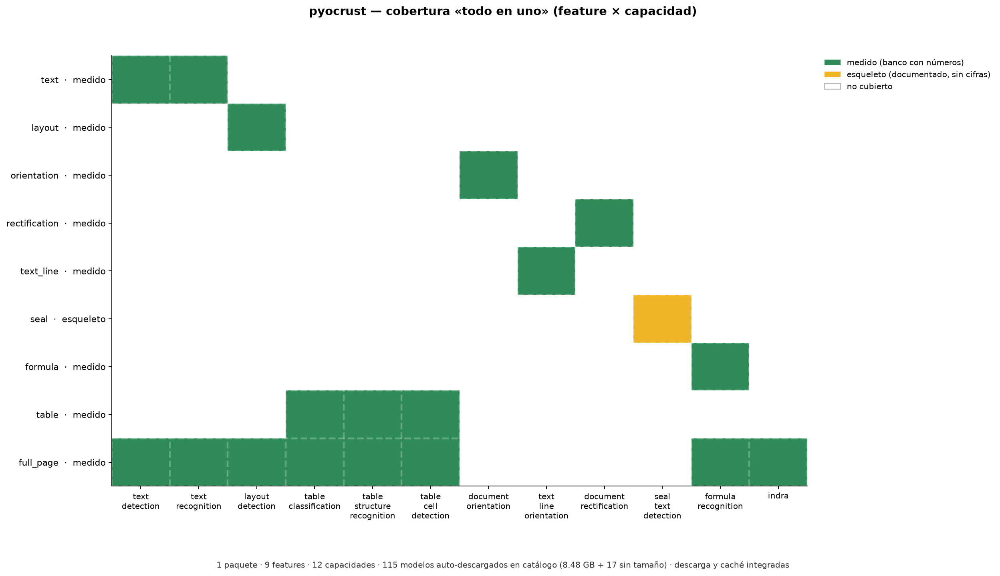

# Cobertura de `pyocrust` — «todo en uno», autogestionado

> **Un solo paquete** cubre **9 features** en **12 capacidades** y **descarga y cachea sus propios modelos** (`ensure_models`), sin servicios externos ni pesos versionados a mano. Lo `medido` se separa siempre de lo `referencia` y lo `esqueleto`.

## Autogestión de modelos

- **`ensure_models`** (Rust, `src/storage/models.rs`) hace *preflight*, descarga en paralelo (4 hilos) lo que falte y **re-verifica** con sidecar `<name>.sha256` (evita re-hashear en caliente).
- La invocan **`VeloceOCR(...)`** y **`TaskPredictor(...)`** en su constructor: pedir un pipeline descarga lo que falte y arranca.
- **Python**: `pyocrust.models_status()` (qué hay y qué falta) y `pyocrust.resolve_models_dir()`; `PYOCRUST_OFFLINE=1` falla con error tipado y el comando exacto si falta un artefacto.
- **Catálogo**: **115 modelos** en 12 capacidades (**8.48 GB** conocidos + 17 sin tamaño publicado).
- **Perfiles de pipeline listos**: `pp_ocrv6_tiny`, `pp_ocrv6_small`, `pp_ocrv6_medium`, `pp_structurev3`, `indra`.

### Catálogo por capacidad

| Capacidad | Modelos | Tamaño conocido | Features que la usan |
| :--- | ---: | ---: | :--- |
| `text_detection` | 7 | 284.9 MB | text, full_page |
| `text_recognition` | 50 | 723.9 MB | text, full_page |
| `layout_detection` | 15 | 1.82 GB | layout, full_page |
| `table_classification` | 1 | 6.8 MB | table, full_page |
| `table_structure_recognition` | 6 | 758.8 MB | table, full_page |
| `table_cell_detection` | 2 | 258.7 MB | table, full_page |
| `document_orientation` | 1 | 6.8 MB | orientation |
| `text_line_orientation` | 3 | 8.8 MB | text_line |
| `document_rectification` | 1 | 31.7 MB | rectification |
| `seal_text_detection` | 2 | 118.3 MB | seal |
| `formula_recognition` | 10 | 4.47 GB | formula, full_page |
| `indra` | 17 | N/A | full_page |

## Matriz feature × capacidad — qué cubre `pyocrust`

`estado`: **medido** = banco ejecutado con números reales; **esqueleto** = documentado, sin cifras (nunca un `0`). Celda **con color** = capacidad que sirve a la feature; celda **blanca** = no la usa.

| Feature | estado | `text_detection` | `text_recognition` | `layout_detection` | `table_classification` | `table_structure_recognition` | `table_cell_detection` | `document_orientation` | `text_line_orientation` | `document_rectification` | `seal_text_detection` | `formula_recognition` | `indra` |
| :--- | :--- | :-: | :-: | :-: | :-: | :-: | :-: | :-: | :-: | :-: | :-: | :-: | :-: |
| **text** | medido | ● | ● | · | · | · | · | · | · | · | · | · | · |
| **layout** | medido | · | · | ● | · | · | · | · | · | · | · | · | · |
| **orientation** | medido | · | · | · | · | · | · | ● | · | · | · | · | · |
| **rectification** | medido | · | · | · | · | · | · | · | · | ● | · | · | · |
| **text_line** | medido | · | · | · | · | · | · | · | ● | · | · | · | · |
| **seal** | esqueleto | · | · | · | · | · | · | · | · | · | ● | · | · |
| **formula** | medido | · | · | · | · | · | · | · | · | · | · | ● | · |
| **table** | medido | · | · | · | ● | ● | ● | · | · | · | · | · | · |
| **full_page** | medido | ● | ● | ● | ● | ● | ● | · | · | · | · | ● | ● |

## Provenance (sin mezclar orígenes)

- **`medido`** (8): `text`, `layout`, `orientation`, `rectification`, `text_line`, `formula`, `table`, `full_page`.
- **`esqueleto`** (1): `seal` — banco y README documentados, sin cifras.
- **`referencia`**:  citan tablas externas **con URL** en su `REPORT.md` (no comparables 1:1).

