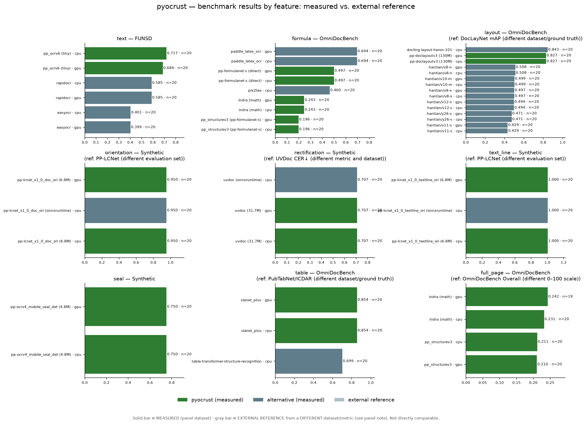
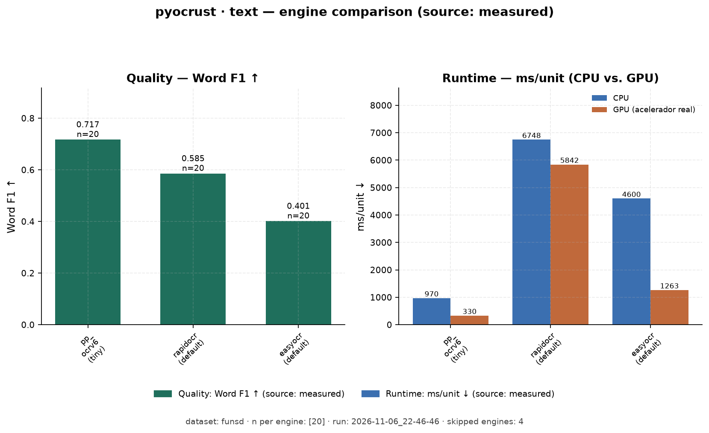
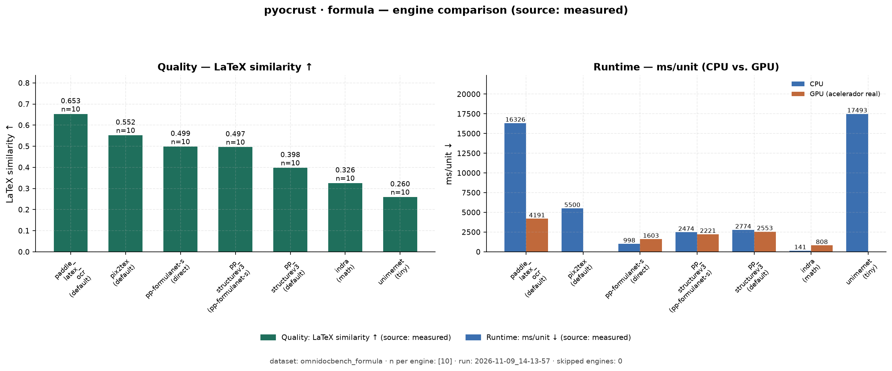
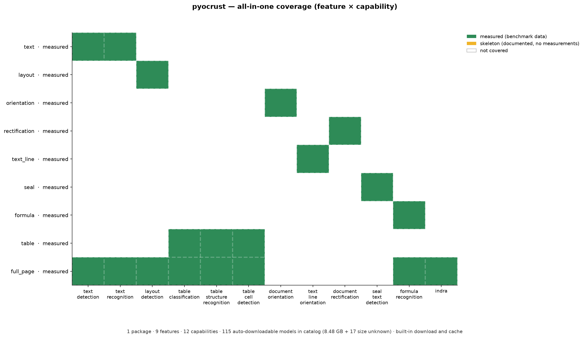
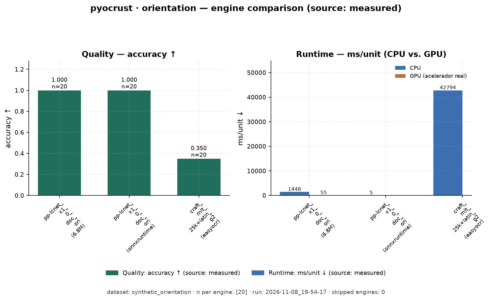
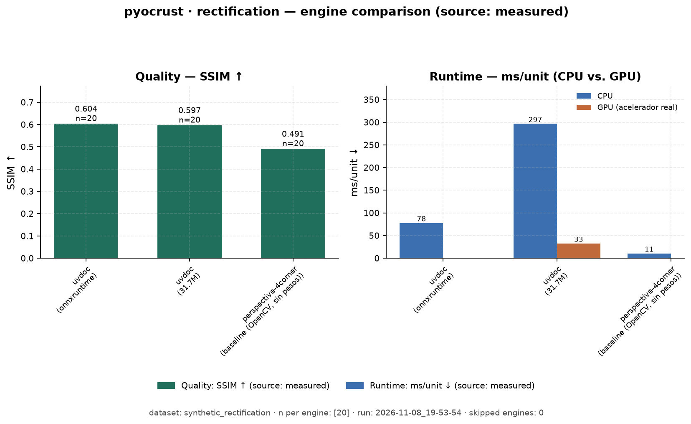
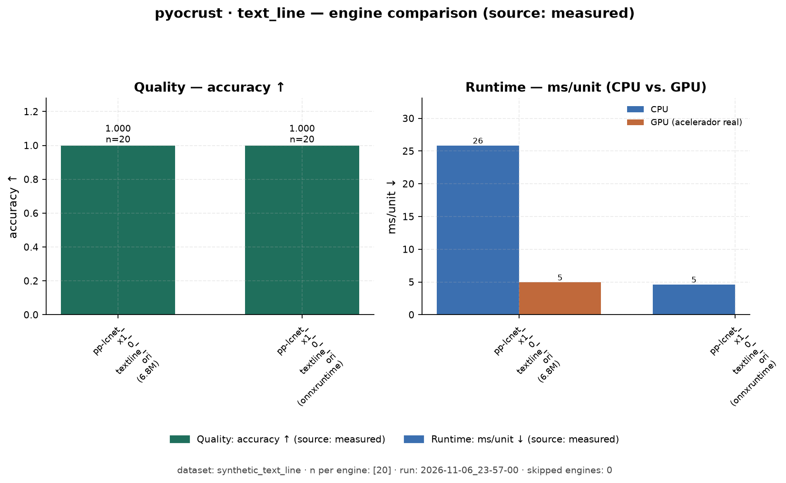
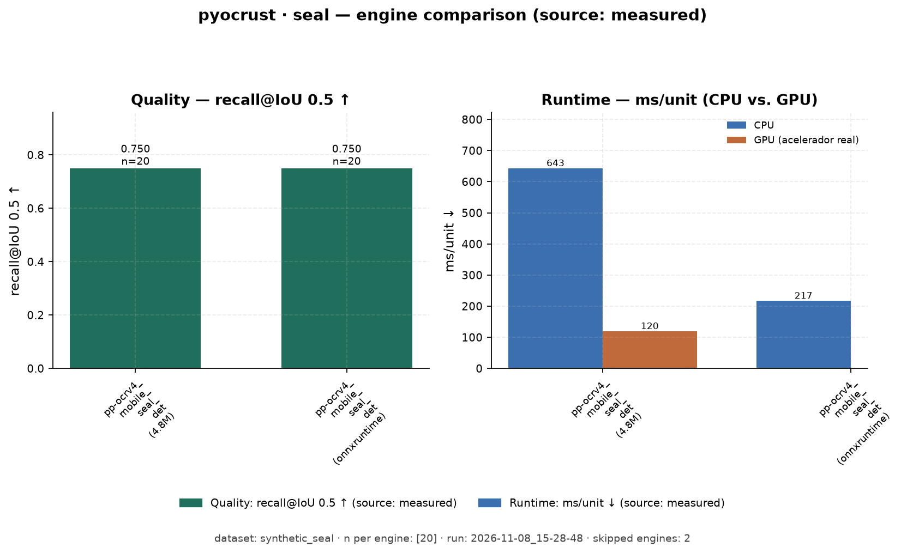
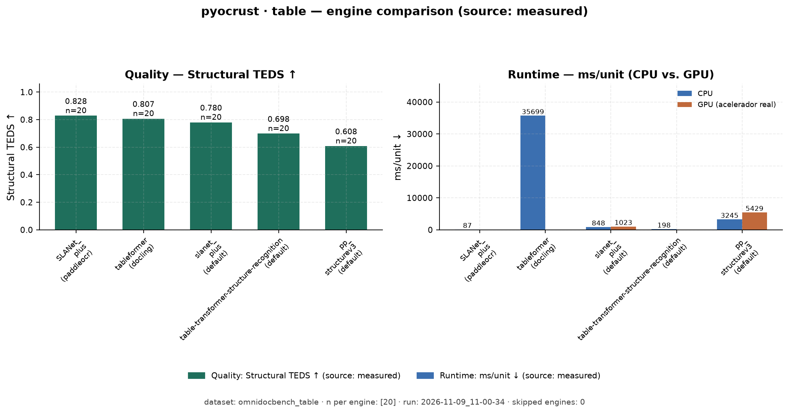
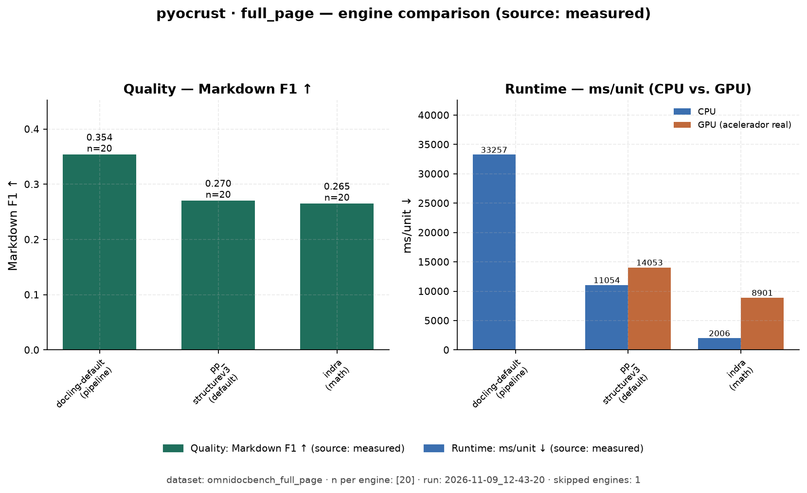

# Benchmarking de `pyocrust`

## Índice por feature (organización vigente)

`benchmarks/` está organizado **por feature/componente** (como los componentes de
`oar-ocr`): cada capacidad del paquete tiene su banco, su métrica y sus
**alternativas Python reales**. Un motor puede cubrir varias features (p. ej. el
pipeline completo resuelve texto + tablas + fórmulas), pero cada banco mide **una**
capacidad y se compara contra alternativas comparables.

| Feature | Estado | Tarea `pyocrust` | Métrica | Alternativas reales | Banquillo |
| :--- | :--- | :--- | :--- | :--- | :--- |
| **text** | implementado | `text_detection` + `text_recognition` | CER/WER/`word_f1` + `box_recall`/`box_iou_mean` | rapidocr, easyocr, tesseract, surya, paddleocr, doctrl | `features/text/` |
| **formula** | implementado | `formula_recognition` (+ pipeline) | `latex_exact`/`latex_sim`/`latex_token_f1` + cobertura LaTeX | **pix2tex, texify, nougat, UniMERNet, Pix2Text, TexTeller, img2latex** | `features/formula/` |
| **layout** | medido | `layout_detection` | mAP@IoU 0.5 | layoutparser, docling, unstructured, paddleocr, TATR | `features/layout/` |
| **orientation** | medido | `document_orientation` | accuracy 0/90/180/270 | paddleocr, docling, surya | `features/orientation/` |
| **rectification** | medido | `document_rectification` | SSIM | paddleocr, docling | `features/rectification/` |
| **text_line** | medido | `text_line_orientation` | accuracy 0/180 | paddleocr, surya | `features/text_line/` |
| **seal** | medido | `seal_text_detection` | recall@IoU 0.5 | paddleocr (seal), doctrl | `features/seal/` |
| **table** | medido | `table_classification`/`_structure`/`_cells` | TEDS | table-transformer, docling, paddleocr | `features/table/` |
| **full_page** | medido | `pp_structurev3` / `indra` | Markdown F1 | docling, unstructured, paddleocr, marker-pdf | `features/full_page/` |

Cada carpeta de feature tiene su `README.md` (qué mide, alternativa y métrica) y
su `bank.py`. El reporte **por feature** se genera con
`features/report.py` y se guarda junto al banco (`reports/<feature>/REPORT.md`).

## Resultados medidos (resumen)

> **`medido`** = ejecutado en este repo (muestra estratificada: `formula` n=10,
> `table` n=8, `full_page` n=6, `layout` n=40; resto n=20 · CPU, `warmup=1`,
> `repeats=1`, pyocrust 0.1.0; campaña 2026-11-08/09); detalle por motor,
> provenance completa y la columna `license` por motor en `reports/<feature>/REPORT.md`.
> **`referencia`** = valor de paper (con URL, panel aparte, **no comparable 1:1**).
> **`pendiente`** = sin datos aún (nunca ceros).
>
> **9 de 9 features medidas.**



Tabla consolidada generada por `features/summary.py`: [`reports/SUMMARY.md`](reports/SUMMARY.md). Regenerar: `.venv/Scripts/python.exe benchmarks/features/summary.py`.

| Feature | Métrica titular ↑ | pyocrust (medido) | Mejor alternativa medida | Run | Estado |
| :--- | :--- | ---: | :--- | :--- | :--- |
| `text` | F1 palabra | 0.717 | rapidocr 0.585 | [text/2026-11-06_22-46-46](results/text/2026-11-06_22-46-46) | medido |
| `formula` | Similitud LaTeX | 0.499 | paddle_latex_ocr 0.653 | [formula/2026-11-09_14-13-57](results/formula/2026-11-09_14-13-57) | medido |
| `layout` | mAP@IoU 0.5 | 0.796 | docling-layout-heron-101 0.818 | [layout/2026-11-09_14-32-35](results/layout/2026-11-09_14-32-35) | medido |
| `orientation` | accuracy | 1.000 | pp-lcnet_x1_0_doc_ori (onnxruntime) 1.000 | [orientation/2026-11-08_19-54-17](results/orientation/2026-11-08_19-54-17) | medido |
| `rectification` | SSIM | 0.597 | uvdoc (onnxruntime) 0.604 | [rectification/2026-11-08_19-53-54](results/rectification/2026-11-08_19-53-54) | medido |
| `text_line` | accuracy | 1.000 | pp-lcnet_x1_0_textline_ori (onnxruntime) 1.000 | [text_line/2026-11-06_23-57-00](results/text_line/2026-11-06_23-57-00) | medido |
| `seal` | recall@IoU 0.5 | 0.750 | pp-ocrv4_mobile_seal_det (onnxruntime) 0.750 | [seal/2026-11-08_15-28-48](results/seal/2026-11-08_15-28-48) | medido |
| `table` | TEDS | 0.914 | tableformer (docling) 0.905 | [table/2026-11-09_14-22-58](results/table/2026-11-09_14-22-58) | medido |
| `full_page` | Markdown F1 | 0.083 | docling-default (pipeline) 0.204 | [full_page/2026-11-09_14-28-38](results/full_page/2026-11-09_14-28-38) | medido |


### `text` — FUNSD, n=20 (detección + reconocimiento)

| Motor | F1 palabra ↑ | WER ord. ↓ | CER ↓ | ms/img ↓ |
| :--- | ---: | ---: | ---: | ---: |
| **pyocrust** (PP-OCRv6 tiny) | **0.717** | **0.360** | 0.483 | **970** |
| rapidocr | 0.585 | 0.512 | **0.476** | 6 748 |
| easyocr | 0.401 | 0.693 | 0.527 | 4 600 |

> Run: `benchmarks/results/text/2026-11-06_22-46-46` (CPU, n=20, warmup=1, repeats=1)



### `formula` — OmniDocBench, n=10 (fórmula → LaTeX)

| Motor | Similitud ↑ | F1 tokens ↑ | Salidas con LaTeX ↑ | ms/fórmula ↓ |
| :--- | ---: | ---: | ---: | ---: |
| **paddle_latex_ocr** (default) | **0.653** | **0.799** | N/A | 16 326 |
| pix2tex (default) | 0.552 | 0.777 | N/A | 5 500 |
| pp-formulanet-s (direct) | 0.499 | 0.652 | N/A | 998 |
| pp_structurev3 (pp-formulanet-s) | 0.497 | 0.708 | N/A | 2 474 |
| pp_structurev3 (default) | 0.398 | 0.613 | N/A | 2 774 |
| indra (math) | 0.326 | 0.575 | N/A | **141** |
| unimernet (tiny) | 0.260 | 0.385 | N/A | 17 493 |

> Run: `benchmarks/results/formula/2026-11-09_14-13-57` (CPU, n=10, warmup=1, repeats=1)



### Cobertura global («todo en uno» + autogestión de modelos)

Resumen de las 9 features y 12 capacidades que cubre el paquete, con la autogestión
de modelos: [`reports/FEATURES_OVERVIEW.md`](reports/FEATURES_OVERVIEW.md).



### Resto de features (gráfica por feature)

`layout` (mAP@IoU 0.5 0.796), `orientation` (acc 1.000), `rectification` (SSIM 0.597),
`text_line` (acc 1.000), `seal` (recall@IoU 0.5 0.750), `table` (TEDS 0.914) y
`full_page` (Markdown F1 0.083) tienen su propio `REPORT.md` + gráfica:

| Feature | Gráfica |
| :--- | :--- |
| layout |  |
| orientation |  |
| rectification |  |
| text_line |  |
| seal |  |
| table |  |
| full_page |  |

### Estructura

```text
benchmarks/
├── README.md            # este índice + contrato
├── common/              # runner, métricas y datasets compartidos
│   ├── runner.py        # orquesta: warmup, repeats, CSV 28 cols, skipped≠ok
│   ├── metrics.py       # CER/WER/word_f1, markdown_f1, block_f1, cajas, LaTeX
│   └── datasets.py      # FUNSD, OmniDocBench, recortes de fórmula, manifests
├── features/<feature>/  # bank.py + README.md (+ SPEC/REFERENCES)
├── reports/<feature>/   # REPORT.md/.en.md + tablas .md/.en.md/.tex
├── figures/<feature>/   # REPORT.png/.svg y gráficas específicas
├── results/             # salidas por feature/<run> (NO se versionan)
└── tests/                # contrato y organización (pytest)
```

### Cómo correr cada banco

```bash
# text (FUNSD con cajas GT) — un backend a la vez, CPU
.venv/Scripts/python.exe benchmarks/features/text/bank.py --limit 5 \
  --backends pyocrust,rapidocr,easyocr,tesseract,surya,paddleocr,doctrl

# formula (recortes de OmniDocBench; compara contra alternativas que SÍ hacen LaTeX)
# Los OCR de texto (easyocr/rapidocr/tesseract) no entran: no emiten LaTeX.
.venv/Scripts/python.exe benchmarks/features/formula/bank.py --limit 10 \
  --backends pyocrust_formulanet,pyocrust_formula,pyocrust_indra,pix2tex --dump-outputs

# medido (imprime su plan y el estado real de sus alternativas; ver REPORT.md)
.venv/Scripts/python.exe benchmarks/features/layout/bank.py

# reporte por feature (provenance + comparativa + skipped)
.venv/Scripts/python.exe benchmarks/features/report.py --all
```

### Regla de provenance (obligatoria)

Todo número en un markdown o gráfico de `benchmarks/` lleva origen explícito:

* **`medido`** — ejecutado por nosotros en este repo; se publica con comando,
  dataset, `n`, `warmup`, `repeats`, CPU/GPU y fecha (lo guarda el `summary.json`).
* **`referencia`** — externo (paper, repo, leaderboard), **solo** con URL + tabla/
  figura + fecha de consulta, marcado como externo. Sin URL verificable **no se pone**.

Nunca se mezclan sin etiquetar. Los artefactos de ejecución (`results/`, CSV
crudos, `*.outputs.json`) **no se versionan**; solo el markdown con valores.

## Gráfica calidad vs tiempo

`benchmarks/features/quality_vs_time.py` genera una **gráfica multigráfica** con un
panel por feature: eje X = `ms` por unidad (izquierda = mejor; log sólo si el rango
supera 1 década), eje Y = índice de calidad (arriba = mejor). Un punto por motor
**medido**; el `device` se anota en el título del panel y la leyenda distingue
`pyocrust` de la alternativa (ambos medidos, provenance de `reports/<feature>/REPORT.md`).

> **Sólo motores medidos** (mismo banco/GT por panel): aquí **no** hay referencias
> externas, así que esta gráfica puede **contradecir** `figures/SUMMARY.png`, que sí añade
> referencias de **otro dataset/métrica** (p. ej. los YOLO sobre DocLayNet en `layout`).

Salidas: `figures/SUMMARY_QUALITY_VS_TIME_CPU.{png,svg}` + `figures/SUMMARY_QUALITY_VS_TIME_GPU.{png,svg}` + `reports/QUALITY_VS_TIME.md` (tabla unificada con columna `Device`).

```bash
.venv/Scripts/python.exe benchmarks/features/quality_vs_time.py
```

Limitaciones conocidas (adversarial review `t_492a5086`): ejes genéricos sin
unidad/métrica por panel (D1), paneles con 1–2 puntos leídos como ranking sin
incertidumbre (D2), `warmup=1`/`repeats=1` sin intercalación (D3), `GPU.md`
puede desincronizarse de `REPORT.md` (D4), sets de motores CPU/GPU distintos
(D5), carga de modelo excluida de `ms` pero no declarada en la gráfica (D6),
n de imágenes no declarado por panel (D7).

## Eje CPU/GPU

La regla dura del eje de proveedor está documentada en [`GPU.md`](GPU.md): un
fallback CPU **nunca** se etiqueta GPU; `pyocrust` confirma `provider_effective`
fila a fila y el banco marca `skipped` si no hay acelerador real.

Resumen de comparativas CPU vs GPU (`text`, `formula`, `layout`, `table`,
`full_page`, `orientation`, `text_line`, `rectification`): valores medidos en
`benchmarks/results/` y `benchmarks/results/_gpu/`.

```bash
# GPU disponible en este host: DirectML
.venv/Scripts/python.exe -m maturin develop --features directml

# text CPU + GPU
.venv/Scripts/python.exe benchmarks/features/text/bank.py    --limit 5 --device cpu --backends pyocrust,rapidocr,easyocr
.venv/Scripts/python.exe benchmarks/features/text/bank.py    --limit 5 --device gpu --backends pyocrust,rapidocr,easyocr --output-dir benchmarks/results/_gpu

# formula CPU + GPU (solo motores que emiten LaTeX)
.venv/Scripts/python.exe benchmarks/features/formula/bank.py --limit 5 --device cpu --backends pyocrust_formula,pyocrust_formulanet,pix2tex
.venv/Scripts/python.exe benchmarks/features/formula/bank.py --limit 5 --device gpu --backends pyocrust_formula,pyocrust_formulanet,pix2tex --output-dir benchmarks/results/_gpu
```

El resto de features (`layout`, `table`, `full_page`, `orientation`, `text_line`,
`rectification`) se reproduce siguiendo la misma pauta; los comandos completos
están en [`GPU.md`](GPU.md) §Reproducir.

## Estado anterior B10 — dataset documental (2026-11-01; superado por la muestra estratificada de 2026-11-09)

> **Histórico.** Esta sección es la primera comparativa multi-tarea sobre
> OmniDocBench; el estado vigente es la muestra estratificada de 2026-11-09
> (`reports/SUMMARY.md` y `reports/<feature>/REPORT.md`). La run `2026-11-01_15-13-03`
> se conserva como registro, no como referencia vigente.

Primera comparativa sobre un **dataset documental** (páginas de documentos
reales, no formularios FUNSD): **`opendatalab/OmniDocBench`** v1.6 — 1651 páginas
de 10 tipos de documento y 5 idiomas (literatura académica, informes, periódicos,
libros, exámenes, notas manuscritas…), con **GT por anotaciones**: cada bloque de
la página trae su `text` o su `latex` y su **orden de lectura**. Cubre las cuatro
casuísticas de `pyocrust` (`text`, `structure`, `formula`, `full_page`).

Run `benchmarks/results/2026-11-01_15-13-03`:

```bash
.venv/Scripts/python.exe benchmarks/run_benchmarks.py --dataset omnidocbench \
  --limit 25 --backends pyocrust,pyocrust_structure,pyocrust_formula,pyocrust_indra,rapidocr,easyocr,tesseract \
  --task-types text,structure,formula,full_page --warmup 1 --repeats 1 --device cpu
```

**25 imágenes por backend**, un backend/modelo cargado a la vez, **150 filas `ok`
y 0 errores**; `tesseract` **skipped** (no instalado). Muestras por `task_type`:
**`text` 75** (tres backends), **`structure` 25**, **`formula` 25**,
**`full_page` 25** — todas **≥ 20**.

Tabla (generada por el reportero, `reports/legacy/benchmark_table.md`):

| Backend (variante; tarea) | n | F1 Markdown ↑ | F1 bloques ↑ | F1 palabra ↑ | WER ord. ↓ | CER ↓ | WER ↓ | ms/pág. | págs/s |
| :--- | ---: | ---: | ---: | ---: | ---: | ---: | ---: | ---: | ---: |
| **pyocrust** (tiny; text) | 25 | N/A | N/A | **0.274** | 1.661 | 1.041 | 1.698 | **1551** | **0.64** |
| rapidocr (default; text) | 25 | N/A | N/A | _0.251_ | **1.380** | 0.966 | 1.420 | 8445 | 0.12 |
| easyocr (default; text) | 25 | N/A | N/A | 0.261 | 1.685 | 1.059 | 1.721 | 10937 | 0.09 |
| pyocrust_indra (math; full_page) | 25 | N/A | N/A | 0.259 | 2.945 | 3.443 | 3.001 | _1045_ | 0.96 |
| pyocrust_structure (default; structure) | 25 | N/A | N/A | 0.216 | 3.608 | 7.196 | 3.647 | 8288 | 0.12 |
| pyocrust_formula (pp-formulanet-s; formula) | 25 | N/A | N/A | 0.004 | 2.527 | 1.876 | 2.527 | 8681 | 0.12 |

**GT sin inventar.** `gt_text` es el **texto anotado de los bloques de prosa en su
orden de lectura** (`run_benchmarks.py::_odb_page_text`); las fórmulas/tablas
(solo `latex`) quedan fuera del GT de texto para no mezclar modalidades. La tarea
`formula` se puntúa contra el **LaTeX anotado** de las fórmulas de la página
(`gt_by_task["formula"]` ← `_odb_page_formulas`). La release **no** publica un
Markdown de página ya renderizado —su anotación es el mismo JSON de bloques—, así
que `markdown_f1`/`block_f1` quedan **N/A** y la calidad Markdown/bloques se marca
**no evaluada** (regla: no inventar GT).

**Lectura honesta.** Sobre páginas reales y difíciles (multicolumna, matemáticas,
varios idiomas), y **solo entre los tres backends de `text`**:

* **Reconocimiento: prácticamente empate.** `pyocrust` gana por poco el **F1 de
  palabra** (0.274 vs 0.251 de `rapidocr` y 0.261 de `easyocr`); el **WER
  orden-neutralizado** lo gana `rapidocr` (1.380 vs 1.661). Con 25 páginas de
  OmniDocBench esas diferencias **no separan** a los motores.
* **Velocidad: gana `pyocrust`.** 1551 ms/página ≈ **5,4× más rápido que
  `rapidocr`** y **≈7,0× que `easyocr`** (CPU, modelo Tiny, un backend a la vez).
* `pyocrust_indra` (`full_page`) es el más rápido de todos (1045 ms/página) y
  reconoce a la altura de los de texto. `structure`/`formula` **corren**, pero su
  calidad de tabla/matemática **no está medida**: no hay Markdown/LaTeX de página
  como referencia exportada, solo su tiempo y un `F1 palabra` parcial.
  `pyocrust_formula` emite LaTeX: su `F1 palabra=0.004` frente al LaTeX anotado
  refleja diferencia de **formato**, no ausencia de reconocimiento.
* **Sin ganador general.** `markdown_f1`/`block_f1` en N/A y velocidades de tareas
  distintas no permiten un ranking global; `model_variant` es nominal y
  `provider_effective="unverified"`.

Detalles de carga y descarga: `--dataset omnidocbench` descarga y cachea la
anotación (`OmniDocBench.json`, 42 MB) y **solo las imágenes de las páginas
elegidas** en `benchmarks/data_cache/` (gitignored); la selección prioriza
páginas con tabla o fórmula. Requiere `huggingface_hub`.

## Estado anterior — comparativa multi-tarea (2026-11-01)

Run `results/2026-11-01_15-04-00`: FUNSD `train`, **10 imágenes por backend**,
**CPU**, `warmup=1`, `repeats=1`, `device=cpu`, Tiny en `text`. CSV de **22
columnas** con **60 filas** (`pyocrust`, `pyocrust_structure`, `pyocrust_formula`,
`pyocrust_indra`, `rapidocr`, `easyocr`), `task_type`/`model_name`/`model_variant`
rellenos en todas las filas; `tesseract` **skipped** (no instalado). Por primera
vez corren las cuatro casuísticas del wrapper (10/10 cada una): los artefactos
PP-StructureV3 que la nota B9 daba por ausentes ya están en `~/.oar`.

| Backend (variante; tarea) | n | F1 Markdown ↑ | F1 bloques ↑ | F1 palabra ↑ | WER ord. ↓ | CER ↓ | WER ↓ | ms/pág. | págs/s |
| :--- | ---: | ---: | ---: | ---: | ---: | ---: | ---: | ---: | ---: |
| easyocr (default; text) | 10 | N/A | N/A | 0.344 | 0.745 | 0.527 | 0.819 | _9356_ | _0.11_ |
| **pyocrust** (tiny; text) | 10 | N/A | N/A | **0.694** | **0.392** | 0.470 | **0.685** | _751_ | _1.33_ |
| pyocrust_formula (pp-formulanet-s; formula) | 10 | N/A | N/A | 0.000 | 1.000 | 1.000 | 1.000 | 3133 | 0.32 |
| pyocrust_indra (math; full_page) | 10 | N/A | N/A | 0.444 | 0.658 | 1.560 | 0.824 | **310** | **3.22** |
| pyocrust_structure (default; structure) | 10 | N/A | N/A | 0.471 | 0.622 | 1.131 | 0.823 | 2643 | 0.38 |
| **rapidocr** (default; text) | 10 | N/A | N/A | _0.590_ | _0.502_ | **0.463** | 0.699 | 9472 | 0.11 |

Lectura honesta:

* **`text` (igual a igual, los tres comparables)**: `pyocrust` gana **F1 palabra**
  (0.694 vs 0.590 `rapidocr` vs 0.344 `easyocr`), **WER orden-neutralizado**
  (0.392) y **velocidad** (751 ms/página ≈ **12,6×** más rápido que `rapidocr` y
  ≈ 12,5× que `easyocr`). El **CER crudo** lo gana `rapidocr` por 0.007
  (0.463 vs 0.470), pero esa columna también mide el orden de lectura y no decide
  la marca.
* **`structure`/`formula`/`full_page`**: ejecutan y quedan registradas. **No hay
  GT Markdown/LaTeX/bloques** en FUNSD, así que `markdown_f1`/`block_f1` son
  **N/A** (no se inventan) y las métricas textuales de estas filas comparan contra
  un GT de texto plano, no contra su modalidad real: `pyocrust_formula` emite
  LaTeX (`"\n".join(result.formulas)`), de ahí su `CER=1,0`/`F1=0,0` — demuestra
  que la casuística corre, **no** una calidad matemática medida.
* **Velocidad entre tareas distintas no es un ranking.** `pyocrust_indra` es el
  más rápido (310 ms) porque devuelve Markdown estructurado; comparar su ms/pág.
  con `pyocrust` `text` no es justo. La marca de velocidad solo tiene sentido
  dentro de `text`.
* **`tesseract` skipped** con motivo; `model_variant` es nominal y
  `provider_effective="unverified"` no demuestra el provider ejecutado (B8).

**Defectos B8 que siguen abiertos** (no invalidan los números medidos, sí la
lectura de las columnas de Markdown como titular): `markdown_f1`/`block_f1` solo
son evaluables con GT legítimo de la misma modalidad; `markdown_f1` es LCS de
tokens ordenados, no equivalencia de documento; `block_f1` compara etiquetas
crudas; memoria/CPU-RAM y versiones de datasets/pesos no se registran.

## Estado anterior B9 (2026-10-31; superado por la comparativa multi-tarea de 2026-11-01)

Crítico R2: **APROBADO acotado** al banco. Regresiones comunicadas:
**21 pass, 17 deselected**, no suite global ni reejecución del escriba.
`results/2026-10-31_23-37-34/summary.json` y CSV registran **5/5 Tiny (`text`),
5/5 Indra (`full_page`, `math`) y 5/5 RapidOCR (`text`)**, sin errores.
La herramienta agotó el timeout: artefactos recuperados, exit code del runner
no observado; no se certifica su terminación correcta.
Estructura/fórmula **skipped**: offline con seis artefactos PP-StructureV3 ausentes,
no generan filas. FUNSD sin GT Markdown/bloques: **calidad Markdown N/A / no evaluada**.
CPU solicitado, `provider_effective=unverified`, `warmup=1`, `repeats=1`:
**sin ganador general, claims GPU ni comparación publicable con cinco muestras**.

**Defectos abiertos (B8):**
1. **CRÍTICO** — `markdown_f1`/`block_f1` vacíos en FUNSD: `gt_markdown`/`gt_blocks`
   son `None` para todas las filas (`run_benchmarks.py:227,525-526,542`); la tabla
   publicada encabeza con `F1 Markdown` pero muestra **N/A** en todas las filas.
2. **MAYOR** — `markdown_f1` mide LCS de tokens ordenados, no equivalencia de
   documento: reordenar secciones baja la puntuación (`run_benchmarks.py:203-218`).
3. **MAYOR** — `block_f1` compara etiquetas crudas sin normalizar; no comparable
   entre motores (`run_benchmarks.py:221-224,314`).
4. **MAYOR** — `model_variant` es nominal; `provider_effective="unverified"` no
   demuestra el provider ejecutado (`run_benchmarks.py:429,445`).
5. **MEDIO** — memoria entre imágenes no medida; CPU/RAM no en meta
   (`run_benchmarks.py:439,471,482,531-556`).
6. **PEQUEÑO** — sin versiones de datasets/HF/pesos; no reproducible exactamente
   entre máquinas (`run_benchmarks.py:531-556`).

> **Nota (`B6`, ver `README.md` §Uso).** El eje `task_type` (columna 18 del CSV)
> se define en el contrato de 22 columnas anterior. La tabla de cobertura de
> `README.md` explica qué `task_type` produce cada predictor y pipeline.

### Contrato vigente (sustituye las definiciones históricas inferiores)

* **28 columnas** (22 históricas + 6 aditivas), cabecera exacta:
  `run_timestamp,backend,dataset,image_id,cer,wer,cer_ord,wer_ord,word_f1,exact_match,elapsed_ms,n_regions,mean_confidence,n_chars_gt,n_chars_pred,status,error,task_type,model_name,model_variant,markdown_f1,block_f1,latex_exact,latex_sim,latex_token_f1,feature,box_recall,box_iou_mean`.
  Las aditivas del banco por feature: `latex_exact`/`latex_sim`/`latex_token_f1`
  (solo `task_type=formula`), `feature` (banco que produjo la fila) y
  `box_recall`/`box_iou_mean` (detección; solo si el dataset anota cajas GT, si no
  quedan vacías). El contrato lo aplica `common/runner.py::CSV_FIELDS`.
* **Backends** registrados en `run_benchmarks.py --backends`:
  `pyocrust` (`pp_ocrv6` tiny → `text`), `pyocrust_structure` (`pp_structurev3` →
  `structure`), `pyocrust_formula` (`pp_structurev3` + `pp-formulanet-s` →
  `formula`), `pyocrust_indra` (`indra` con `math(true)` → `full_page`),
  `rapidocr` (`text`), `easyocr` (`text`), `tesseract` (`text`).
  Los no instalados aparecen como `skipped` en `summary.json`, nunca como `ok`.
* `--task-types text,structure,formula,full_page` filtra tareas fijas; no convierte
  salidas. `pyocrust_formula` (`pp_structurev3`, `pp-formulanet-s`) usa
  **`"\n".join(result.formulas)`**, no Markdown de página; Indra devuelve Markdown.
* `--manifest ruta/manifest.json`: array JSON, `image` relativa al manifiesto,
  `id` opcional, `text` GT textual (omitido: cadena vacía), `markdown` GT Markdown/
  LaTeX, `blocks` lista de etiquetas. GT legítimo de la misma entrada/modalidad,
  nunca texto FUNSD convertido artificialmente en Markdown. Esquema ilustrativo,
  no GT real: `[{"image":"pagina.png","text":"Texto anotado","markdown":"# Texto anotado","blocks":["title"]}]`.
* `markdown_f1`: F1 LCS de tokens sensible al orden, case preservado dentro de
  `$...$`/`$$...$$` (usar delimitadores en GT LaTeX). **No es equivalencia de
  documento**: reordenar secciones baja la puntuación (B8). `block_f1`:
  multiconjunto de etiquetas **crudas** (no normalizadas), no geometría
  (B8). Vacías en `text` o sin GT: reportero muestra **N/A**.
* `cer_ord`: Levenshtein sobre **caracteres** de palabras normalizadas, ordenadas
  y unidas con espacios; `wer_ord` sobre listas de palabras. No son idénticos.
  CSV legacy sin `task_type`: antiguo `cer_ord` duplicaba WER, se invalida como
  **None / N/A**, no cero ni CER vigente.
* `--repeats N` (N >= 1): tiempo medio por imagen, calidad de la última salida;
  metadatos guardan tiempos individuales/p95 y `load_ms`, separado de inferencia
  y warmup. `--device cpu|gpu`: **gpu rechazada con `skipped`**, motivo
  `GPU selection not exposed; refusing CPU fallback`, nunca CPU etiquetada GPU.
  `provider_effective=unverified` no demuestra el provider ejecutado.
* Reportero agrupa backend/variante/tarea; marcas solo dentro de la misma tarea,
  calidad textual en `text`, Markdown en las otras. Gráfico de velocidad con
  tareas distintas no permite ranking general. Los informes legacy son mutables en
  `reports/legacy/` y sus gráficos en `figures/legacy/`.

```bash
# Ejemplos futuros, no ejecutados por B9; siempre --run explícito
.venv/Scripts/python.exe benchmarks/run_benchmarks.py --limit 5 --backends pyocrust,pyocrust_structure,pyocrust_formula,pyocrust_indra,rapidocr --task-types text,structure,formula,full_page --repeats 1 --device cpu
.venv/Scripts/python.exe benchmarks/run_benchmarks.py --manifest ruta/manifest.json --backends pyocrust_indra --task-types full_page --repeats 2 --device cpu
.venv/Scripts/python.exe benchmarks/report_benchmarks.py --run benchmarks/results/2026-10-31_23-37-34
```

## Histórico B3/B4 (2026-10-25; no estado vigente)

Se conserva el registro original siguiente, incluidos comandos/contratos y
rankings superados. No reutilizar como post aprobado ni ganador general;
prevalece la nota B9 y su contrato de 22 columnas.

Banco de pruebas **fuera de `src/`** que mide la **calidad** y la **velocidad** de
`pyocrust` frente a otros OCR sobre un dataset real, y genera la tabla y los
gráficos que se publican (README del repositorio).

Todo se ejecuta con el intérprete del venv local `.venv/Scripts/python.exe`
desde la **raíz del repositorio**.

## Qué mide

Sobre las **mismas imágenes** (FUNSD, formularios escaneados):

* **Calidad** por imagen: `cer`, `wer`, `word_f1` y `exact_match`.
* **Velocidad** por imagen: `elapsed_ms` (y, agregado, ms/página y páginas/s).

Cada backend se calienta con el mismo *warmup* y corre sobre las mismas imágenes.
Los backends que no están instalados (o cuyos modelos faltan) se registran como
`skipped` con el motivo, **nunca** como si hubieran corrido.

| Fichero | Qué es |
| :--- | :--- |
| `common/runner.py` | Runner **compartido** (movido aquí en la reorganización por feature): carga el dataset, ejecuta los backends (un modelo a la vez), `warmup`/`repeats` y escribe el CSV de 28 columnas + `summary.json` (con comando y parámetros = provenance). |
| `common/metrics.py` | Métricas: CER/WER/`word_f1`, `cer_ord`/`wer_ord`, `markdown_f1`, `block_f1`, cajas (`iou`/`box_metrics`) y LaTeX (reexporta `latex_metrics.py`). |
| `common/datasets.py` | Carga de datasets con GT: FUNSD (texto + cajas), OmniDocBench (texto + LaTeX), recortes de fórmula y manifests locales. |
| `features/<feature>/bank.py` | Banco **por feature** (9 features implementadas y medidas). |
| `reports/<feature>/REPORT.md` | Reporte por feature (provenance + comparativa + `skipped`), generado por `features/report.py`. |
| `run_benchmarks.py` | CLI histórica, viva: mantiene el mismo contrato de CSV que `common/runner.py` (22 columnas + aditivas) y sigue siendo el driver de las runs de página completa. Los bancos por feature usan `common/runner.py`. |
| `report_benchmarks.py` | Reportero legacy de CSV: guarda informes y metadatos en `reports/legacy/` y gráficos en `figures/legacy/`. |
| `reports/` | Informes Markdown/LaTeX, por feature en `reports/<feature>/`; la subcarpeta `legacy/` conserva salidas del agregador anterior. |
| `figures/` | Gráficos PNG/SVG, por feature en `figures/<feature>/`; `legacy/` contiene salidas del agregador anterior. |
| `results/<feature>/<run>/` | Salida por run: `<ts>.csv`, `<ts>.meta.json`, `<backend>.meta.json` y `summary.json`. **No se versiona.** |
| `data_cache/` | Caché local de FUNSD (`nielsr/funsd`) y OmniDocBench. Gitignored. |
| `tests/` | Contrato del CSV/organización por feature (`test_features.py`) y pruebas funcionales (`test_functional.py`). |

## Cómo ejecutarlo

```bash
# 0) Dependencias del banco (una sola vez). `pyocrust` ya debe estar compilado
#    en el venv con `maturin develop` (ver README.md del repositorio).
.venv/Scripts/python.exe -m pip install datasets pillow matplotlib

# 1) Benchmark: FUNSD train, 30 imágenes, pyocrust vs. rapidocr vs. easyocr
.venv/Scripts/python.exe benchmarks/run_benchmarks.py --limit 30 --backends pyocrust,rapidocr,easyocr

# 2) Tablas y gráficos a partir de la run más reciente (¡ojo, ver «Provenance»!)
.venv/Scripts/python.exe benchmarks/report_benchmarks.py

# 2b) ...o de todas las runs acumuladas
.venv/Scripts/python.exe benchmarks/report_benchmarks.py --all
```

Salidas: `benchmarks/results/<timestamp>/` (CSV + metadatos), `benchmarks/reports/legacy/` (tabla)
y `benchmarks/figures/legacy/` (gráficos).

### Opciones útiles

```bash
# Medir también el pipeline de estructura (necesita los modelos de PP-StructureV3)
.venv/Scripts/python.exe benchmarks/run_benchmarks.py --backends pyocrust,pyocrust_structure

# Cambiar tamaño de muestra, split y warmup
.venv/Scripts/python.exe benchmarks/run_benchmarks.py --limit 50 --split test --warmup 2

# Agregar solo una run concreta
.venv/Scripts/python.exe benchmarks/report_benchmarks.py --run benchmarks/results/2026-10-25_22-07-24
```

Backends disponibles en `run_benchmarks.py --backends`:

* `pyocrust` — preset `pp_ocrv6` (PP-OCRv6, modelo **Tiny**, es el defecto).
* `pyocrust_structure` — preset `pp_structurev3` (PP-StructureV3).
* `rapidocr` — `rapidocr-onnxruntime`.
* `easyocr` — requiere `easyocr` + `torch`.
* `tesseract` — requiere `pytesseract` + el binario de Tesseract.

Los que no estén instalados aparecen como `skipped` en el `summary.json` de la run.

## Contrato del CSV

Una fila por combinación `(backend, imagen)`. Cabecera exacta, **17 columnas**:

```text
run_timestamp,backend,dataset,image_id,cer,wer,cer_ord,wer_ord,word_f1,exact_match,elapsed_ms,n_regions,mean_confidence,n_chars_gt,n_chars_pred,status,error
```

| Columna | Tipo | Significado |
| :--- | :--- | :--- |
| `run_timestamp` | str | Marca de la run (`%Y-%m-%d_%H-%M-%S`). |
| `backend` | str | `pyocrust` / `pyocrust_structure` / `rapidocr` / `easyocr` / `tesseract`. |
| `dataset` | str | `funsd`. |
| `image_id` | str | Identificador de la imagen en FUNSD. |
| `cer` | float | *Character Error Rate* (menor es mejor). **Sensible al orden de lectura.** |
| `wer` | float | *Word Error Rate* (menor es mejor). **Sensible al orden de lectura.** |
| `cer_ord` | float | CER con orden neutralizado: ordena el multiconjunto de palabras antes del Levenshtein. Mide reconocimiento, no disposición. |
| `wer_ord` | float | WER con orden neutralizado (idéntico a `cer_ord` por definición). |
| `word_f1` | float | F1 a nivel de palabra, independiente del orden (mayor es mejor). |
| `exact_match` | float | `1.0` si el texto normalizado coincide exactamente; si no, `0.0`. |
| `elapsed_ms` | float | Milisegundos de la inferencia (sin contar el *warmup*). |
| `n_regions` | int | Nº de regiones/cajas devueltas por el backend. |
| `mean_confidence` | float | Confianza media auto-reportada por el backend. |
| `n_chars_gt` | int | Caracteres del ground truth normalizado. |
| `n_chars_pred` | int | Caracteres de la predicción normalizada. |
| `status` | str | `ok` o `error`. Un backend no disponible **no genera fila** (solo `skipped` en el `summary.json`). |
| `error` | str | Mensaje de error si `status = error`; vacío si `ok`. |

La normalización aplicada antes de comparar es la misma para todos: minúsculas y
espacios colapsados.

## Cómo interpretar cada métrica

* **`cer` ↓** — caracteres erróneos / caracteres del ground truth. `0.0` = texto
  idéntico; `0.45` ≈ el 45 % de los caracteres no coinciden.
* **`wer` ↓** — igual que el CER, pero a nivel de palabra.
* **`word_f1` ↑** — F1 sobre el **multiconjunto** de palabras: no castiga que el
  OCR lineal y el ground truth recorran un formulario multicolumna en distinto
  orden. `1.0` = mismo vocabulario; `0.0` = ninguna palabra en común.
* **`exact_match` ↑** — coincidencia del texto completo normalizado. En OCR real
  suele ser `0.0`: falla un solo carácter y ya es `0`.
* **`ms/pág.` ↓** y **`págs/s` ↑** — velocidad (`mean_ms` y `1000 / mean_ms`).
* **`mean_confidence`** — confianza media que reporta cada motor. **No es
  comparable entre backends**: cada uno usa su propia escala.
* **`cer_std`** — desviación típica del CER entre imágenes; mide la dispersión,
  no la media.

El `report_benchmarks.py` marca en **negrita** el mejor backend por métrica y en
*cursiva* el segundo; solo agrega filas con `status = ok`.

**Qué métrica decide la marca.** Solo rankean `word_f1`, `cer_ord`, `wer_ord`,
`mean_ms` y `pages_per_s`. El `cer`/`wer` **crudos** se publican pero **no llevan
marca**: miden también el orden de lectura, y con un formulario multicolumna esa
penalización es inequitativa entre motores (B4/D1). La regla de orden del
*ground truth* (fila, luego columna) no coincide con el recorrido lineal que
produce un OCR, y castiga más a quien más se desvía de ella.

## Estado de la última ejecución registrada

Los artefactos legacy de `reports/legacy/` y `figures/legacy/` que documentan esta página se generaron con
`report_benchmarks.py --run benchmarks/results/2026-10-25_22-26-51` — dataset FUNSD
`train`, `--limit 30`, `warmup = 1`, **30 imágenes medidas por backend** — en
**CPU**, sin GPU. Es la run posterior a la revisión metodológica de `B4`.

| Backend | Estado | Motivo |
| :--- | :--- | :--- |
| `pyocrust` | ok (30/30) | — |
| `rapidocr` | ok (30/30) | — |
| `easyocr` | ok (30/30) | — |
| `pyocrust_structure` | no incluido | faltan 6 artefactos del preset `pp_structurev3` |
| `tesseract` | no incluido | `pytesseract` + binario de Tesseract no instalados |

Tabla resultante (`reports/legacy/benchmark_table.md`, generada por el reportero):

| Backend | n | F1 palabra ↑ | WER ord. ↓ | CER ↓ | WER ↓ | ms/pág. | págs/s |
|---|---|---|---|---|---|---|---|
| easyocr | 30 | 0.426 | 0.670 | 0.526 | 0.794 | 3247 | 0.31 |
| pyocrust | 30 | **0.745** | **0.325** | 0.487 | 0.670 | **643** | **1.56** |
| rapidocr | 30 | _0.607_ | _0.487_ | 0.482 | 0.699 | 4534 | 0.22 |

Lectura honesta: `pyocrust` gana en **F1 de palabra** (0.745), en **WER con orden
neutralizado** (0.325) y en **velocidad** (643 ms/página, 1.56 págs/s: ~7× más
rápido que `rapidocr` y ~5× que `easyocr`). El **CER crudo** lo sigue ganando
`rapidocr` (0.482 vs 0.487), pero esa columna mide también el orden de lectura
y **no decide la marca**; con el orden neutralizado `pyocrust` gana por 0.162.
Todo con el modelo **Tiny** (preset por defecto), en CPU y con n=30: indicios
sólidos, no un veredicto de paper.

Los valores agregados completos (incluidos `median_ms`, `p95_ms`, `cer_std` y
`mean_confidence`) están en `reports/legacy/benchmark_summary.json`.

> **Provenance.** `report_benchmarks.py` se puede re-ejecutar en cualquier
> momento, así que estos números son los que se conservan en `reports/legacy/` y `figures/legacy/` cuando se
> escribió esta documentación (run `2026-10-25_22-07-24`). Una run posterior los
> sustituye.

## Limitaciones conocidas

* **Modelo Tiny.** `pyocrust` corre con el preset `pp_ocrv6` (PP-OCRv6), un
  modelo **Tiny**; no es la variante grande. Compararlo con el modelo por defecto
  de `rapidocr` **no es igual a igual** en capacidad.
* **Solo CPU.** La ejecución registrada no usa GPU (features `cuda`/`directml`
  sin activar); los milisegundos valen para CPU, no para un despliegue con GPU.
* **Muestra pequeña.** Se midieron **29 imágenes** (el defecto del runner es 20);
  hay `cer_std`, pero no intervalos de confianza ni test de significancia.
* **FUNSD solo en inglés.** Son formularios escaneados en inglés: el banco no
  mide español, manuscrito ni documentos largos.
* **Ground truth lineal.** FUNSD se linealiza ordenando las palabras por caja
  (fila y luego columna); el orden real de un OCR lineal no tiene por qué
  coincidir. Por eso la métrica que debería encabezar la calidad es `word_f1`
  (independiente del orden), no el CER.
* **Entrada distinta por backend.** `pyocrust` recibe los **bytes PNG
  re-codificados** de la imagen (`_image_bytes`); `rapidocr` recibe un array RGB
  de NumPy. No es la misma ruta de preprocesado y puede afectar al tiempo medido.
* **Cobertura parcial.** Corrieron tres backends (`pyocrust`, `rapidocr`,
  `easyocr`); siguen pendientes `pyocrust_structure` (faltan artefactos del preset
  `pp_structurev3`) y `tesseract` (no instalado).
* **Versiones no fijadas.** La run registra Python, plataforma y versión de
  `pyocrust` (`summary.json` → `runtime`), pero **no** fija la versión exacta de
  los modelos ONNX ni la de los baselines.
* **El reportero usa por defecto solo la run más reciente.** `report_benchmarks.py`
  sin `--run` lee únicamente la última carpeta de `results/` (comparaciones
  limpias); con `--all` agrega todas las runs y mezcla sus filas en una media.
